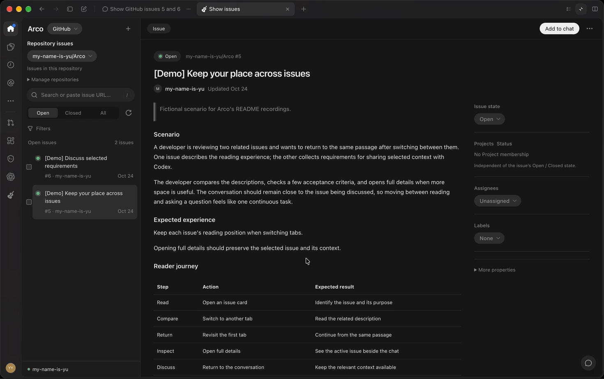
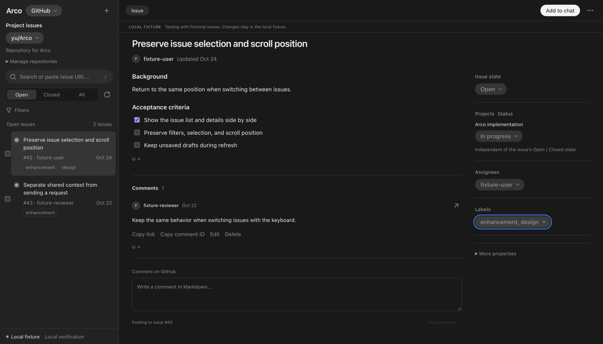
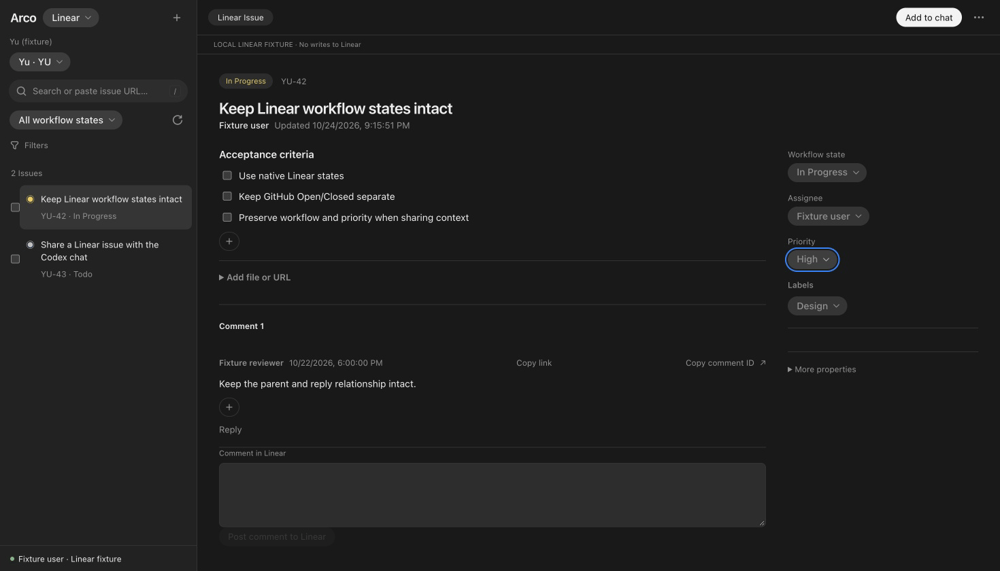

# Arco

An MIT-licensed Codex plugin for browsing and editing GitHub and Linear issues, and bringing selected issue context into your conversation.

## Keep issues beside the conversation

Read and compare issue cards inside your conversation, then open full details in the side panel.


## Bring the right context into chat

Select passages across issues and collect them as numbered context beside your next prompt.



## Edit where you read

Update Markdown and labels directly from the issue workspace.



## Work with Linear's own fields

Read Linear issues and update their native workflow states and priorities.



_The first two clips show Arco in Codex with fictional demo issues. The editing and Linear clips use sample data in a browser preview. Typing is shown at 4× speed; waiting and some scrolling are also sped up._

Arco runs a local Node.js MCP server and an embedded React interface. It connects directly to your issue providers, uses your existing GitHub CLI login, and stores Linear credentials in the operating system's credential store. There is no Arco account or hosted backend.

GitHub and Linear remain the sources of truth. Arco preserves each provider's native fields and does not synchronize the two services.

## Install

You need a Codex desktop environment with local plugin and interactive MCP UI support, the `codex` CLI, Git, npm, and Node.js **24.22.1 or later within Node 24**. The desktop app must be able to find `node` and, for GitHub, the [`gh` CLI](https://cli.github.com/) on its executable search path. The GitHub CLI must support `gh auth token --no-refresh`.

The prebuilt npm package targets **macOS on Apple Silicon**. Node.js and the GitHub CLI are separate prerequisites. Linear requires a working OS credential store; there is no plaintext credential fallback.

### Prebuilt plugin

Install the prebuilt `arco-codex-plugin` through Arco's marketplace:

```sh
codex plugin marketplace add my-name-is-yu/Arco
codex plugin add arco@arco-marketplace
```

The repository contains the distribution catalog; npm provides the built plugin and its native credential-storage binding. Installation does not build from source or run npm lifecycle scripts.

### Install from source

Build on the target OS and architecture: the source build includes its native keyring binding and cannot be copied across platforms. Windows and Linux require native validation before support can be claimed; Linux also needs an unlocked Secret Service.

```sh
git clone https://github.com/my-name-is-yu/Arco.git
cd Arco
npm ci
npm run build
codex plugin marketplace add ./dist
codex plugin add arco@arco-local
```

The build generates a local catalog at `dist/.agents/plugins/marketplace.json` pointing to `dist/plugin/`. Build before installing and keep the checkout for updates. Both installation methods install a cached copy. Restart the desktop app, start a new conversation, and run Arco's setup skill. Connect the service you want to use; either service can be used independently.

## Connect your providers

For GitHub, authenticate with the CLI:

```sh
gh auth login --web
gh auth status
```

Arco uses the selected GitHub.com account and its existing permissions. For GitHub Projects, review and grant the additional scope with `gh auth refresh --hostname github.com --scopes project`. Open **My issues** for the initial **Assigned to me** list, or **Project issues** to choose a repository for the conversation.

For Linear:

1. Create or use a [Linear OAuth application](https://linear.app/developers/oauth-2-0-authentication) that your account and workspace can authorize.
2. Register the exact callback `http://127.0.0.1:53187/oauth/linear/callback`.
3. Open Arco's Linear view, enter the client ID, and select **Authorize in Linear**. No client secret is needed.
4. Finish browser authorization, verify the connected account and workspace in Arco, and select a team.

Linear tokens are stored in the OS credential store. Your application's access settings determine who can connect; the maintainer's development application is not a shared public connection.

## Update or remove

For a prebuilt installation, refresh the catalog and installed plugin:

```sh
codex plugin marketplace upgrade arco-marketplace
codex plugin add arco@arco-marketplace
```

For a source installation, preserve local changes before updating, then rebuild:

```sh
git pull --ff-only
npm ci
npm run build
```

Existing source installations that registered the repository root with `codex plugin marketplace add .` need this one-time migration after rebuilding:

```sh
codex plugin marketplace remove arco-local
codex plugin marketplace add ./dist
```

After the migration, and on subsequent source updates, refresh the installed copy:

```sh
codex plugin add arco@arco-local
```

Restart the desktop app and start a new conversation to load the update. If native keyring loading fails, check that the prebuilt package supports your OS and architecture; for a source installation, reinstall dependencies and rebuild on that machine. If Linear authorization fails, check the registered callback, available port 53187, and unlocked credential store.

To uninstall a prebuilt installation:

```sh
codex plugin remove arco@arco-marketplace
codex plugin marketplace remove arco-marketplace
```

For a source installation, use `arco@arco-local` and `arco-local` instead.

Disconnect Linear in Arco first if you want to remove its stored credential. Uninstalling leaves local settings and drafts separate from provider grants; revoke Linear authorization through Linear when needed. Shared GitHub CLI credentials remain managed by `gh`.

## Develop locally

```sh
npm ci
npm run dev
```

The fixture host builds and displays fictional issues without live provider access. It is a browser preview; actual Codex desktop behavior and live writes require separate checks. The build produces `dist/plugin/` for installation and `dist/dev/` for fixture development. Rebuild after source changes; `npm run dev:fixture` starts an existing build without hot reload. See [Publishing the plugin](CONTRIBUTING.md#publishing-the-plugin) for npm package validation and release setup.

See [CONTRIBUTING.md](CONTRIBUTING.md) for validation commands and contribution policy. Repository documentation, comments, and authored examples are written in English; provider content is displayed in its original language.

## Specifications

- [Requirements](docs/requirements.md)
- [Issue operations](docs/issue-operations.md)
- [Screen behavior](docs/screen-structure.md)
- [Security and privacy](docs/security-and-privacy.md)

## Contributing and support

Start with a short issue and get maintainer approval before opening a pull request. Read [CONTRIBUTING.md](CONTRIBUTING.md) for the scope, quality bar, and AI-assisted contribution policy. For vulnerabilities, follow [SECURITY.md](SECURITY.md).

Arco is an independent project and is not an official OpenAI, GitHub, or Linear product.

## License

Arco's code and documentation are licensed under the [MIT License](LICENSE). Dependencies retain their own licenses; a build generates `dist/plugin/THIRD_PARTY_NOTICES.txt`. Third-party names and any content retrieved from providers remain the property of their respective owners.
