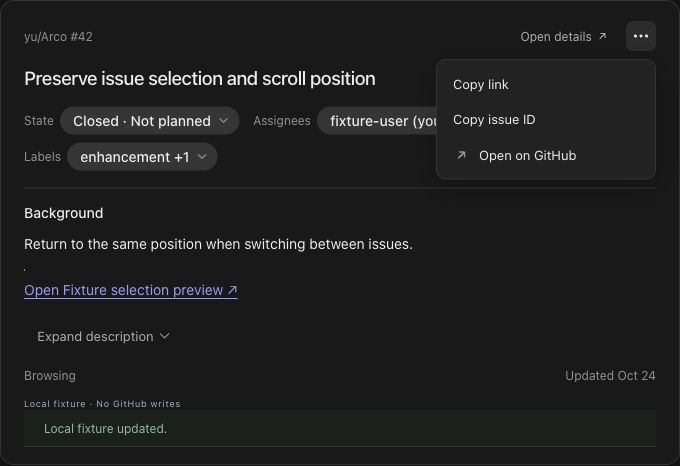

# Arco

An MIT-licensed Codex plugin for browsing and editing GitHub and Linear issues, and bringing selected issue context into your conversation.

Arco runs a local Node.js MCP server and an embedded React interface. It connects directly to your issue providers, uses your existing GitHub CLI login, and stores Linear credentials in the operating system's credential store. There is no Arco account or hosted backend.

## What you can do

- Browse personal GitHub issues or choose a repository for a project conversation.
- Work with Linear issues in an explicitly selected workspace and team.
- Read and edit issue content, properties, comments, labels, and supported relationships.
- Manage GitHub Projects fields separately from an issue's open/closed state.
- Show an issue as an inline card or open its full details in a panel.
- Add an entire issue or several numbered selections, with optional comments, to the Codex composer.

GitHub and Linear remain the sources of truth. Arco preserves each provider's native fields and does not synchronize the two services. See the [product scope](docs/product-scope.md) and [operation reference](docs/issue-operations.md).



The screenshot shows the local fixture interface, not a live provider connection or native Codex verification.

## Install from source

You need a Codex desktop environment with local plugin support, Git, npm, and Node.js **24.22.1 or later within Node 24**. GitHub integration also requires the [`gh` CLI](https://cli.github.com/). Linear requires an OAuth application client ID that you configure for your own installation.

```sh
git clone https://github.com/my-name-is-yu/Arco.git
cd Arco
npm ci
npm run build
codex plugin marketplace add .
codex plugin add arco@arco-local
```

Restart the desktop app, start a new conversation, and run Arco's setup skill. Connect the service you want to use; both services are optional individually.

The local catalog is an installation mechanism for the source build. Arco's OSS distribution does not depend on listing in the official public plugin directory. The catalog points to `dist/plugin`, so build before installing and reinstall after rebuilding. See [installation and updates](docs/installation.md) for provider setup, platform requirements, and troubleshooting.

Native behavior has been exercised on **macOS arm64**. Windows and Linux need separate builds and native desktop validation; this Mac's keyring binary cannot be reused across platforms. See the [platform matrix](docs/platform-validation.md) for evidence and limitations.

## Develop locally

```sh
npm ci
npm run check
npm run test:browser
npm run dev:fixture
```

`check` runs static checks, unit tests, builds, MCP smoke checks, and artifact validation. The fixture host uses fictional issues and does not fall back to live provider APIs. It is a browser preview, not proof of Codex desktop behavior.

The build produces `dist/plugin/` for installation and `dist/dev/` for fixture development. The plugin includes the project license, third-party notices, and the native keyring binding installed on the build machine.

See the [development guide](docs/development.md), [architecture](docs/technical-stack.md), and [contribution guide](CONTRIBUTING.md). Repository documentation, comments, and authored examples are written in English; provider content is displayed in its original language.

## Documentation

- [Documentation index](docs/index.md): user guides, architecture, and dated validation records.
- [Installation](docs/installation.md): build, install, connect, update, and remove.
- [Security and privacy](docs/security-and-privacy.md): data flow, credentials, and shared context.
- [Local data](docs/local-data-boundary.md): settings, drafts, retention, and invalid-data handling.
- [Implementation status](docs/implementation-status.md): implemented behavior and remaining validation.
- [Design and accessibility checks](design-qa.md): interaction and presentation guidance.

## Contributing and support

Start with a short issue and get maintainer approval before opening a pull request. Read [CONTRIBUTING.md](CONTRIBUTING.md) for the scope, quality bar, and AI-assisted contribution policy. For vulnerabilities, follow [SECURITY.md](SECURITY.md).

Arco is an independent project and is not an official OpenAI, GitHub, or Linear product.

## License

Arco's code and documentation are licensed under the [MIT License](LICENSE). Dependencies retain their own licenses; a build generates `dist/plugin/THIRD_PARTY_NOTICES.txt`. Third-party names and any content retrieved from providers remain the property of their respective owners.
