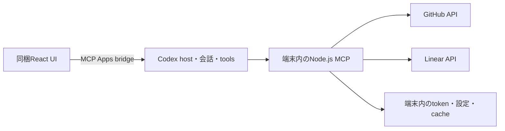

> 履歴資料。2026-10-22の実装開始時の記録であり、現在の作業指示ではありません。現行の構成は[技術スタック](../technical-stack.md)を参照してください。

# Arco 技術スタック

更新日: 2026-10-22
状態: Code Reviewに基本構成を揃える方針と、実装開始時の技術基準を具体化。ソース非公開の無料plugin。公開SDKの互換性は隔離環境で検証し、製品の依存導入・本体実装は次セッションで行う。認証・起動・全表示のCodex実機検証は未完了。

## 実装の基準

Code Reviewと同じReact・Tailwind・TanStack Query・Node.js ESM・stdio MCPの構成を基本にする。同じ構成で実現できるものへ独自の仕組みを足さない。Code Reviewの専用backend・first-party bridge・review保存機構をそのままArcoへ取り込む意味ではない。

バージョンはCode Reviewの配布物を丸ごと複製せず、公開SDKで型チェックと通信が通る組み合わせを使う。[依存互換性と検証記録](../dependency-compatibility.md)を実装開始時の基準とする。

## 採用構成

React + TypeScript + Vite、Tailwind + 公開Apps SDK UI、TanStack Query、Node.js + 公式MCP SDK + MCP Apps/OpenAI extensions、Zodを採用する。
Code Reviewと基本的な構成を近づけ、Arcoの採用済み操作を実装する。Code Review専用のhost連携・review保存機構は取り込まない。

UI assetsとNode.jsのlocal stdio MCPをpluginへ同梱し、元サービスへ直接接続する。独自backend、Arcoログイン、課金・利用権管理のAPI/DBは構成に含めない。



| 領域             | 構成                                                                    | 役割                                                                                                                       |
| ---------------- | ----------------------------------------------------------------------- | -------------------------------------------------------------------------------------------------------------------------- |
| UI               | React + TypeScript                                                      | 一覧・詳細・編集を共有し、inline/fullscreenの領域と役割に合わせて表示する。PiPは2026-10-23に採用取り消し                   |
| UI build         | Vite                                                                    | 静的なHTML/JS/CSSを生成してMCP UI resourceとして提供する。配布時のdev serverは不要                                         |
| UI部品・スタイル | `@openai/apps-sdk-ui` + Tailwind/CSS変数                                | 公開の部品・tokenを基に、hostテーマ、情報密度、フォーカス・キーボード操作を合わせる                                        |
| API由来データ    | TanStack Query                                                          | 取得、ページ取得、更新後の無効化・再取得、ローディング/エラー状態                                                          |
| 画面内の状態     | React state                                                             | 選択、filter、展開、未送信draft。別の大きな状態管理ライブラリは前提にしない                                                |
| MCP server       | Node.js LTS + TypeScript / local stdio                                  | source認可、入力検証、API呼び出し、同梱UI resource提供。UIとCodexのtoolが同じ操作実装を使う                                |
| Protocol         | 互換版を揃えた公式MCP TypeScript SDK + MCP Apps SDK + OpenAI extensions | 標準bridge、global/thread入口、表示形式、会話連携。手書きJSON-RPCを製品の通信層に育てない                                  |
| 入力検証         | Zod                                                                     | tool引数とsource別操作の境界を検証。採用SDKの互換版に合わせる                                                              |
| GitHub接続       | Code Reviewと同様の公開`gh` CLI経路を先に検証                           | `gh api`のREST/GraphQLで採用操作・Projects・認可を満たせるか確認。独自OAuthや別API clientを必要性の確認前に追加しない      |
| Linear接続       | GraphQL / 公式`@linear/sdk`                                             | native Issue操作とupload。SDKはserver側だけで使い、取得結果を小さなJSONへ変換する。認可は別途実証する                      |
| 保存             | source tokenは端末内の安全なcredential storage。設定/下書き/cacheは端末 | Issueの正本は各source。独自Issue DB・mirror・全件index・アカウントDBは作らない。[データ境界](../local-data-boundary.md)を参照 |

単一repo・小さな単位で始め、UI、server、source別API操作、host連携を分ける程度にする。多数packageのmonorepo基盤は要件にしない。
Next.js/SSR、独自のchat/agent framework、任意sourceのplugin frameworkを追加する根拠はない。
React Router等もCode Reviewに同梱されていることだけを理由に採用しない。必要な画面遷移が決まってから選ぶ。

## 採用する公開SDKの組み合わせ

| 役割                | 実装開始時の基準                                                           |
| ------------------- | -------------------------------------------------------------------------- |
| React / ReactDOM    | `19.3.1`                                                                   |
| TypeScript          | `6.0.3`、strict。UI/serverともbundle前提の`moduleResolution: Bundler`      |
| Vite / React plugin | `8.3.5` / `@vitejs/plugin-react@6.1.2`                                     |
| Tailwind            | `4.3.3`、`@tailwindcss/vite@4.3.3`                                         |
| 公開UI部品          | `@openai/apps-sdk-ui@0.2.2`                                                |
| Query               | `@tanstack/react-query@5.104.5`                                            |
| MCP server          | `@modelcontextprotocol/sdk@1.32.1`                                         |
| MCP Apps            | `@modelcontextprotocol/ext-apps@1.7.5`                                     |
| OpenAI extensions   | `@openai/mcp-extensions@0.2.1`のrootと`/app`。`/server` helperは使用しない |
| Zod                 | `4.4.3`へ統一。OpenAI extensionsのexact依存と揃える                        |
| 開発・検証Node      | LTS `24.22.1`。ホストが起動に使うNodeの提供方法は実機確認する              |

MCP v2は公開済みだが、現OpenAI extensionsとMCP Apps v2にはpeer不一致がある。v1 server＋v1 Appsと最新OpenAI app helperなら、独自protocol・fork・force installを使わずに必要なdraft schemaとMCP通信を扱えた。これは現時点の互換基準であり、v1を恒久固定する判断ではない。

backendはSDK v1と`registerAppTool` / `registerAppResource`を使う。global/thread入口・display mode・composer検索は、公開metadata型とschemaを標準tool/resourceへ宣言する。frontendは`App`とOpenAIの`/app` helperを使う。Node server v2を要求する`/server` helperを混ぜない。

## プロジェクト構成と型の境界

一つの`package.json`とnpmのlockfileで管理する。依存はexact versionを記録し、CIは`npm ci`を使う。workspace管理や別のpackage managerを導入する理由はない。

```text
src/
  ui/          React画面、host連携、Query、選択・未保存draft
  server/      MCP登録、github/、linear/、必要な認可・端末保存
  shared/      tool引数のZod schema、Issue参照とJSON DTO
scripts/       UI/server build、plugin package、protocol smoke
tests/         複数境界を通すテスト。単体テストは対象の近くに置く
plugin/        製品manifestと配布用設定
dist/          生成物。開発ソースとは分ける
```

- UIからserver、Node組込み、source SDKをimportしない。sharedにはtoken・SDK model・server実装を置かない。
- 共通化はsource付きIssue参照、一覧要約、表示用エラー等に絞る。詳細・属性・更新入力はGitHub/Linear別の型を保つ。
- すべての操作を持つ巨大な共通Issue型、汎用provider registry、任意操作を受ける`executeOperation`は作らない。
- Zodはtool引数・通信境界で使い、型を導出する。全内部関数へ重複schemaを追加しない。
- SDKのmodel instanceやraw responseをtool結果へ渡さず、必要なJSONだけ返す。本文・コメント・tokenをログへ出さない。

## UI・状態・本文編集

TanStack Queryは取得済みのsourceデータ、React stateは選択・filter・編集中の値を持つ。別iframeや別会話で一つの「現在のIssue」を共有しない。

- query keyにはsource・接続・対象repo/team・Issue/Project/field・検索条件を含め、別対象の結果を混ぜない。
- 再取得で未保存draftを上書きしない。保存成功後は該当詳細と一覧を無効化し、sourceの実結果を取得する。
- 書き込みの自動再試行を一律に有効化しない。コメントやIssue作成の二重実行、bulkの部分失敗を扱う。
- 会話toolからの更新は、公開host通知・画面復帰・再取得で反映する。正確な契機はCodexで検証し、独自event busや常時mirrorを作らない。
- 最初の本文編集はtextarea＋preview。MarkdownはApps SDK UIの`Markdown`を使い、`react-markdown` / `remark-gfm`を重複して直接依存へ足さない。
- GFMの表示と原文保持を基本にし、raw HTML実行を追加しない。数式の専用レンダリングは現時点では追加しない。
- Router、追加global store、rich-text editor、virtualization、drag-and-dropは、具体的な画面・性能上の必要性が出た場合に限って選ぶ。

表示resourceを返すtoolと、通常の検索・読取・更新toolを分ける。データ更新のたびに表示resourceを返して、画面全体をremountさせない。会話連携には公開のMCP Apps / OpenAI helperを使い、JSON-RPCやCodexの会話基盤を自作しない。

## buildと配布

Code Reviewのように静的UIとNode ESM serverを配布する。UIはVite＋`vite-plugin-singlefile@2.3.4`でHTML一つにまとめ、serverはesbuildのNode ESM bundleを基本にする。`tsc`は型チェックを担う。開発用dev serverや`tsx`を配布物の起動条件にしない。

Apps SDK UIの標準CSSには未使用でも外部KaTeX font参照が残る。数式を有効化しない基準では、対象の未使用font-faceだけをPostCSS ASTで除き、UIコード・CSS・fontの外部取得を不要にする。数式を採用する場合は依存に含まれるfontのinlineが可能であることも検証済み。build後に外部script/style、CSS URL、dynamic importの残存を検査する。

source画像・添付の取得はUIコードの配布と分ける。必要な認可とCSPを確認し、source tokenをiframeへ渡して解決しない。

起動はCode Reviewの配布設定を参考に、一般pluginでも同じNode提供・起動方法を使えるかを先に検証する。観測した`CODEX_MCP_NODE_PATH`は、第三者向け公開契約を確認済みでも使用不可と確認済みでもない。
**Node binaryの同梱、独自launcher、auto installer、SEA、OS別shell、native保存ライブラリは現段階で必須構成へ追加しない。** 追加setupなしで起動できるかを確認し、不足が判明したものだけ選ぶ。

非公開配布物に不要なsource map、開発fixture、credentialを含めない。依存license noticeを同梱する。artifactのinstall時に依存をネットから取る前提にはしない。

## 認証・保存の追加を決める順番

Code Reviewの公開CLI利用を参考に、GitHubは既存`gh`認証と`gh api`で採用操作を満たせるか検証する。CLI引数はshell文字列へ連結せず、引数配列で呼ぶ。Projectsの認可と、`gh`が未導入・未認証の場合の導入体験も確認する。
Code ReviewのChatGPT backend経由のGitHub providerは、Arcoが使える公開接続として確認済みではない。

Linearの認可は別に必要である。直接OAuthが必要になった場合は、providerの公開仕様に沿った小さなhelperと安全なtoken保存を選ぶ。GitHubも直接OAuthが必要と判明してからApp/OAuth Appを選ぶ。

設定・下書きは小さなJSON、表示cacheはメモリを基本にする。credentialは安全な保存先へ置き、平文JSON・UI・モデル・ログへ返さない。具体的なcredential保存package、atomic writeやprocess間lockは、必要性とOS動作の確認後に決める。[データ境界](../local-data-boundary.md)を参照。
Code ReviewのSQLiteはreview記録用であり、それだけを理由にArcoへDBを追加しない。独自backend、アカウント、Issue DB、同期daemonは引き続き作らない。

## 品質確認

| 段階         | 使用するもの・確認すること                                                                                                        |
| ------------ | --------------------------------------------------------------------------------------------------------------------------------- |
| 静的確認     | TypeScript strict、ESLint 10＋typescript-eslint＋React Hooks、Prettierを一つのformatterとして使用                                 |
| ロジック・UI | Vitest＋Testing Library。ラベル保持、field/Project誤更新、bulk部分失敗、draft保持、全域の選択共有とmessageを送信しないこと        |
| ブラウザ     | Playwrightで一覧・詳細・編集・キーボード・狭い幅を確認。mock hostと実Codexを区別する                                              |
| 配布artifact | manifest/依存/外部assetsの残存、stdio initialize・tool/resourceの一覧と呼出し、クリーン環境の起動                                 |
| Codex実機    | 採用したinline/fullscreen、composer選択、Issue全体・全域の選択共有、Codex側のタイトル・グループ付き添付と通常入力、更新後のUI反映 |

OSの完成形は、ユーザー指定どおりCodexアプリが動く環境を対象にする。macOS・Windows・Linuxを想定してOS固有のpathやshellへ寄せず、実際にhostが対応するOS/archで検証する。LinuxのCodex GUIやheadless/CLI対応まで確認済みという意味ではない。

CIは対応OSでtypecheck・必要なテスト・build・MCP smokeを行う。実アカウントのIssue更新を通常CIへ含めず、source認可と実書込みは本人が選んだ検証対象で別に行う。ブラウザやstdioの成功をCodex実機の完了に置き換えない。

## 次セッションの開始点

1. この基準で一つのpackageを作り、依存をexact指定してlockfileを生成する。
2. Code Reviewを参考に、一般pluginとしてのNode起動と、GitHubの公開CLI経路を最小で検証する。専用backendを接続先として使わない。
3. 公開SDKのUI resourceと会話4連携を、実際のCodexで確認する。
4. GitHubの採用操作と一覧・詳細を実装し、Linearは同じUI/通信境界へ追加する。提供順と未決UXを、完成形の機能削減と混同しない。

先に認証・保存・配布を独自frameworkにせず、Code Reviewと同じ方法で成立するものから使う。

## 導入済みCode Reviewで確認した構成

対象はこのMacの通常配布plugin `26.1016.61520`。元の開発repo、完全なpackage/lockfile、build configが公開・配布されていると確認したわけではない。

| 技術              | 確認できたこと                                                                        | 根拠                                                                                  |
| ----------------- | ------------------------------------------------------------------------------------- | ------------------------------------------------------------------------------------- |
| React/ReactDOM    | bundleのversionは19.2.7                                                               | [UI JS:1][ui-react]、[UI JS:1661][ui-reactdom]                                        |
| Tailwind          | 生成CSSのbannerは4.3.3                                                                | [CSS:1][ui-css]                                                                       |
| TanStack Query    | QueryClient/Provider実装と固有の診断文字列、実際のProvider使用。package versionは不明 | [UI JS:1653][ui-query]、[UI JS:8672][ui-app]                                          |
| Radix系primitives | popper/focus/dismissable-layerの実装markerあり。直接依存package/versionは不明         | [UI JS:3550][ui-primitives]                                                           |
| React Router      | RouterProvider等と固有の診断文字列あり。version不明                                   | [UI JS:1684][ui-router]                                                               |
| Vite              | CSSに`$vite$` marker。関与は強い推測で、設定全体は不明                                | [CSS:3][ui-vite]                                                                      |
| TypeScript        | server bundleの元ソース名に`server/index.ts`等。frontendのTSXやcompiler設定は不明     | [server:46367][server-ts]                                                             |
| Backend           | Node.js ESM、stdio MCP、MCP SDK 1.29.0、ext-apps 1.7.5、Zod 4.4.3のbundle元情報       | [server:12574][server-sdk]、[server:36270][server-apps]、[server:47402][server-stdio] |

Code Reviewが公開の`@openai/apps-sdk-ui`を使っていることまでは確認していない。Arcoへの採用は、公開で利用でき、hostに馴染むUIを作るための推奨。
Code Reviewのfirst-party専用bridgeやprivate reviewの保存は、標準MCP Appの公開APIと区別する。[専用bridge][private-bridge]
配布assetsは調査の根拠とし、製品ソースやprivate protocolをコピーしない。

## 同じversionに揃えるか

Code Reviewの依存versionをそのまま固定する必要はない。構成を参考にして、公開SDKとUI部品の互換性を確認した版でlockする。
MCP TypeScript SDK公式は現在v2をstable、旧`@modelcontextprotocol/sdk`のv1をmaintenanceと説明している。今回のv1基準は公開package間の互換性を実証した結果であり、Code Reviewに入っているという理由だけではない。公式extensionsのpeerが揃った段階でv2を再確認し、恒久固定や独自forkを前提にしない。[MCP SDK公式](https://ts.sdk.modelcontextprotocol.io/)

## 小さく保つための責務

- UIはMCP toolを直接呼ぶ。通常のボタン操作ごとにAI応答を経由しない。
- データ操作toolと表示resourceを分け、更新ごとにカード全体を再生成・remountしない。[OpenAI UIガイド](https://developers.openai.com/plugins/build/chatgpt-ui)
- Query cacheにはsource/account/repo/team/Issue/Project/field等、実際の取得対象を識別できるkeyを使う。共通Statusを合成しない。
- Queryはiframe間の同期基盤ではない。会話toolや別表示からの変更は、確認できた通知・画面復帰・明示更新等を契機に再取得する。独自event busやmirrorを作らない。
- 標準MCP Appsを基礎にし、必要なOpenAI extensionsだけを足す。first-party専用APIが使える前提にしない。

## スタックとは別に決める項目

公開を目指すsource認証・配布の調査と残件は[認証・配布](../auth-distribution.md)を参照。ソース非公開の無料提供・local構成の採用と、外部提供資格・実動作の確認を区別する。ソース非公開の方針によって基本stackを変えない。

1. local stdio MCPの公開資格、Code Reviewに近いNode起動方法の利用可否、配布/update方法。現在のprobe launcherにある個人Macの絶対pathは配布設計ではない。
2. GitHub/Linear認証。既存のCodex接続やtokenをArcoが流用できると仮定しない。localの本人用接続と公開OAuthを分けて設計する。
3. 永続UI設定・下書き・secretの保存先。Issue正本の保存と区別する。
4. fullscreenと会話4連携のCodex上の検証。ライブラリ採用だけではhost対応は証明されない。
5. ソース非公開の無料配布に必要な利用条件と、同梱依存物のlicense notice。端末へ配るassetsやMCPに秘密を埋め込まない。

公開SDKの基準versionとpackage構成は上記に従い、依存導入時にlockfileへ記録する。認証・配布・Codex実機での未検証事項は別に確認し、技術スタック全体を再選定する理由にしない。

## 公開資料

- [OpenAI: Add UI](https://developers.openai.com/plugins/build/chatgpt-ui) — MCP Appsを基礎とし、公開UI部品の利用も案内。
- [OpenAI: Design system](https://developers.openai.com/plugins/concepts/ui-guidelines#design-system) — Apps SDK UI、Tailwind、CSS変数token。
- [OpenAI: Extensions](https://developers.openai.com/plugins/build/extensions) — global/thread入口・表示形式・会話連携。
- [Vite](https://vite.dev/guide/) — React/TypeScriptと静的assetsのbuild。
- [TanStack Query](https://tanstack.com/query/latest/docs/framework/react/overview) — source由来データの取得・cache・更新。

[ui-react]: /Users/yuyoshimuta/.codex/plugins/cache/openai-bundled/code-review/26.1016.61520/assets/pull-requests.js:1
[ui-reactdom]: /Users/yuyoshimuta/.codex/plugins/cache/openai-bundled/code-review/26.1016.61520/assets/pull-requests.js:1661
[ui-css]: /Users/yuyoshimuta/.codex/plugins/cache/openai-bundled/code-review/26.1016.61520/assets/pull-requests.css:1
[ui-query]: /Users/yuyoshimuta/.codex/plugins/cache/openai-bundled/code-review/26.1016.61520/assets/pull-requests.js:1653
[ui-app]: /Users/yuyoshimuta/.codex/plugins/cache/openai-bundled/code-review/26.1016.61520/assets/pull-requests.js:8672
[ui-primitives]: /Users/yuyoshimuta/.codex/plugins/cache/openai-bundled/code-review/26.1016.61520/assets/pull-requests.js:3550
[ui-router]: /Users/yuyoshimuta/.codex/plugins/cache/openai-bundled/code-review/26.1016.61520/assets/pull-requests.js:1684
[ui-vite]: /Users/yuyoshimuta/.codex/plugins/cache/openai-bundled/code-review/26.1016.61520/assets/pull-requests.css:3
[server-ts]: /Users/yuyoshimuta/.codex/plugins/cache/openai-bundled/code-review/26.1016.61520/server.mjs:46367
[server-sdk]: /Users/yuyoshimuta/.codex/plugins/cache/openai-bundled/code-review/26.1016.61520/server.mjs:12574
[server-apps]: /Users/yuyoshimuta/.codex/plugins/cache/openai-bundled/code-review/26.1016.61520/server.mjs:36270
[server-stdio]: /Users/yuyoshimuta/.codex/plugins/cache/openai-bundled/code-review/26.1016.61520/server.mjs:47402
[private-bridge]: /Users/yuyoshimuta/.codex/plugins/cache/openai-bundled/code-review/26.1016.61520/assets/pull-requests.html:151
