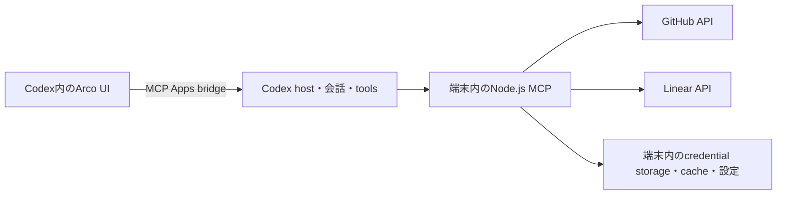

# Arco 認証・公開配布

更新日: 2026-10-22
状態: 全製品scopeのソース非公開での無料提供と、UI + local stdio Node.js MCPから元サービスへ接続する構成を採用済み。Code Reviewと同じ構成・既存の接続手段を優先し、Codexアプリが対応する環境での動作を目指す。認可・起動の実証、公開資格、具体的な利用条件は未確定。外部登録・申請・接続変更・公開は行っていない。

## 採用する構成

Arcoは無料のCodex pluginとして提供する。合意済みのIssue操作・会話連携・表示形式を、有料機能へ分けない。
独自Arcoアカウントやログイン、利用権管理のためのAPI・DBは作らない。元サービスへの認可だけを行い、独自backendを必要としない構成とする。
配布ZIP・UI assets・導入案内ページ等の静的hostingは、この独自backendに含めない。

| 層 | 役割 | 認証・保存の境界 |
| --- | --- | --- |
| Codex → plugin UI / local MCP | 同梱UIとstdio MCPを利用する | Codexの利用条件はArcoの無料提供と別 |
| local MCP → GitHub/Linear | Issue等を本人の権限で取得・更新する | GitHubは公開`gh` CLI経由を先に検証し、Linearは認可方式を別途検証する |
| 端末内の保存 | credentialは安全な既存保存先を優先し、設定・下書きはJSON、表示cacheはメモリに保持する | source tokenをUIやモデルへ返さない |

MCPはAPI接続とUI・会話連携のための通常のプロセスであり、独自agent実行基盤は作らない。
GitHub/LinearとCodexのアカウント・権限・契約は、それぞれのサービスの条件に従う。Arcoが無料でも元サービスの制限や必要な契約を置き換えるものではない。

## 既存GitHub/Linear接続を使い回せるか

確認した公開契約は次のとおり。

- local/workspace packageは`.app.json`で登録済みMCPを参照できる。参照だけで権限や認証を得るわけではない。[既存app参照](https://learn.chatgpt.com/docs/enterprise/plugin-management#reference-an-existing-app-with-appjson)
- Directoryのsubmission portalは既存integrationへの参照を公開しない。公開提出は`With MCP`でそのMCP自体を提出する。[submission errors](https://developers.openai.com/plugins/deploy/submission-errors#mcp-server-reference-errors)
- 標準UIの`tools/call`は、接続されたMCPのtoolを呼ぶ契約。別pluginの接続済みcredentialをArcoへ渡す公開契約は今回確認できなかった。[UIガイド](https://developers.openai.com/plugins/build/chatgpt-ui)
- 会話中のCodexが既存GitHub/Linear toolを呼べることと、ArcoのUI/serverがその接続を直接利用できることは別。
- 今回モデルに公開されたGitHub tool一覧だけでは、Projectsや組織Issue fieldsを含む採用済み操作を全面的に委ねる根拠が不足していた。既存connectorの全能力や将来の対応を断定するものではない。

したがって既存pluginのcredential移譲は前提にしない。一方、GitHub CLI等の公開された接続経路を使うことは別の選択肢であり、Code Reviewを参考に先に検証する。first-party専用bridgeやbackendを利用できる前提にはしない。

## GitHubへの認可

Code Reviewの配布コードではGitHub CLI認証と専用ChatGPT providerを確認した。Arcoでは公開されている`gh` CLI経由の接続をまず検証する。専用providerを利用できるとは扱わず、`gh`が本人の認可で採用済み操作・個人/組織Projects・private repoを扱えるか、導入と再接続のUXまで確認する。
`gh`のcredentialをArcoへ複製することを前提にせず、CLIの公開API操作を使えるかから確認する。これは既存GitHub pluginの接続を移譲することとは異なる。

`gh`経由で要件を満たせない場合に、Arco用のGitHub App/OAuth認可が必要かを決める。以下はその場合の候補であり、先に実装する必須構成ではない。接続方式の都合で採用済みProjects機能を削らない。

| 選択肢 | 利点 | 確認事項・代償 |
| --- | --- | --- |
| GitHub App | 利用repoを選べ、Issue操作に関係する権限へ絞りやすい | 個人所有Projectsを含む全採用操作への対応を要確認 |
| OAuth App一本 | 接続・token管理が単純で、user/org Projects向けの`project` scopeを利用できる | private repo向けの`repo` scopeはコード操作等まで広い。UIのrepo選択は認可scopeの制限にはならない |
| GitHub App＋必要時に追加OAuth | 最小権限を基本にして個人Projectsを補う候補 | 接続が2系統になるため、必要性とscopeを検証するまで採用しない |

GitHub Appを採用する場合、UI/会話からの本人操作にはuser access tokenを用いる。installation tokenによる独立した自動操作を追加しない。[GitHub Appの選択](https://docs.github.com/en/apps/creating-github-apps/about-creating-github-apps/deciding-when-to-build-a-github-app)、[本人操作のtoken](https://docs.github.com/en/apps/creating-github-apps/about-creating-github-apps/best-practices-for-creating-a-github-app)

公式RESTの個人所有Project items APIはGitHub App user/installation tokenとfine-grained PATを非対応と明記する。この記述だけでGraphQLも非対応と断定はしない。
接続候補ごとに個人Projectの一覧・Issue追加・Status/対応型の更新を、GraphQLを含む最小検証で確定する。[Project items API](https://docs.github.com/en/rest/projects/items#update-project-item-for-user)、[OAuth scopes](https://docs.github.com/en/apps/oauth-apps/building-oauth-apps/scopes-for-oauth-apps)

自前の端末内認証が必要になった場合の候補はdevice flow。GitHub App/OAuth Appともclient secretを配らずtokenを取得でき、device flowで発行したtokenの更新もsecret不要という公開仕様がある。
通常のauthorization-code flowはPKCE対応でもclient secretが必要なため、同一視しない。実際のCodex環境で取得・更新・失効・再接続を検証する。[OAuth App認可](https://docs.github.com/en/apps/oauth-apps/building-oauth-apps/authorizing-oauth-apps)、[GitHub App更新](https://docs.github.com/en/apps/creating-github-apps/authenticating-with-a-github-app/refreshing-user-access-tokens)

## Linearへの認可

Linearの接続はGitHubとは別に必要であり、Code ReviewのGitHub接続だけでは解決しない。Arco用OAuth、`actor=user`、`read,write`を候補とする。本人操作に必要な認可とし、admin/agent権限は求めない。
PKCEによる認可code交換はclient secretを省略でき、PKCE発行tokenの更新もsecret不要という公開仕様がある。登録済みcallbackからlocal MCPへ戻る経路を実装検証する。[Linear OAuth](https://linear.app/developers/oauth-2-0-authentication)

現行仕様はaccess token 24時間、refresh時に新しいrefresh tokenも返す。connectionごとに更新・失効・再接続を扱う。
teamを一覧で選ぶことと、OAuthの認可範囲をそのteamだけへ限定することは区別する。

## 認可・保存に追加実装が必要な場合

Code Reviewと同じNode.js構成と既存の接続手段を優先し、認可・保存をArcoが追加で管理する必要があるかを先に確かめる。開発検証にはNode.js 24.22.1を使い、ホスト経由の起動は確認できた契約に従う。
自前OAuthが必要ならNode標準`fetch`・`crypto`・`http`による小さなprovider別helperを候補とする。独自Arcoアカウントがないため、Better Auth等のaccount/session基盤は追加しない。

source tokenをArcoで保存する必要がある場合は、OS credential storeのbinding等を検討し、平文ファイルへfallbackしない。keyring・path解決・atomic write・filelockの追加依存は、必要性が確定した項目だけ採用する。
複数MCP processによる更新競合とtoken rotationは要実証。Arco自身が更新を管理する場合は、接続単位の排他、保存済みcredentialの再取得、token pairの整合性が必要になる。特定のfilelock packageを先に必須化しない。

Arcoの接続解除とprovider側のgrant取消は分ける。Arcoが管理する設定・credentialだけを解除対象とし、共有`gh`認証の削除やログアウトを暗黙に行わない。localでの解除だけでprovider上の認可も取り消したとは表示しない。

保存・排他の境界は[端末内データ](local-data-boundary.md)、依存versionの理由・SDKとの差と検証事項は[依存互換性](dependency-compatibility.md)を参照。

## 無料提供とソース公開

現時点ではソース非公開の無料pluginとして提供する。開発repoを非公開で管理し、配布成果物・導入資料を公開する。OSS化は行わず、具体的な利用条件と依存物のlicense noticeを公開前に整える。
公式submission仕様で`repository`と`license`はOptionalであり、確認した公開資料の範囲では一般配布にOSSを義務付ける条件は見当たらない。採用した提供方針と、配布経路の条件・公開審査への適合は別に確認する。[package metadata](https://developers.openai.com/plugins/deploy/submission#package-identity-and-components)

local MCPとUIの配布コードは利用者の端末に届き、読まれ得る。ソース公開方針にかかわらずclient secretやprivate keyを配布物へ埋め込まない。
ソース非公開は、配布コードを秘密の保管場所として扱えるという意味ではない。

## pluginとしての公開

サポート方針は「Codexアプリが対応する環境で動くこと」。macOS・Windows・Linuxを想定し、実際のCodex対応OS・archを対象に検証する。headless環境やCLIへの対応を自動的に追加しない。

UI assetsとlocal stdio MCPを含むpluginを公開配布することを目指す。公式directoryへの公開資格と第三者Issue clientの審査適格性は未確認。
現行資料ではlocal stdio MCPのDirectory提出にはapproved partnerのallowlistが必要。probeのlocal導入成功を一般公開資格の証明にしない。[Submission](https://developers.openai.com/plugins/deploy/submission)、[Desktop-only](https://developers.openai.com/plugins/deploy/desktop-only)

非公式connectorやpass-through層を主目的とするpluginには承認上の制限がある。Arcoの独自UI・Issue操作・会話workflowがどう評価されるかを確認する。
無料提供にしたことだけでこの制限を満たすとは扱わず、審査のために合意済みの製品scopeを増やさない。[第三者連携の規定](https://developers.openai.com/plugins/plugin-guidelines#third-party-content-and-integrations)

公開のために自動的にremote MCPへ変更しない。独自backendを必要としない構成と、採用済みの操作・会話連携を保てる配布経路を確認する。

Code Review配布で使われているホストNodeの起動経路を、最小probeで確認する。`CODEX_MCP_NODE_PATH`は公開資料で契約を確認できていないが、そのことだけで利用不可とも断定しない。実際のpluginで提供・起動・対応環境を確かめてから採否を決める。
開発検証はNode.js 24.22.1と、必要に応じて公式例の`command: "node"`を使う。製品でユーザーへNodeの手動導入を求めるか、Nodeを同梱するか、別の起動方法が必要かは今決定しない。自動installer・SEA・独自launcher・daemonは追加しない。[desktop-onlyの起動例](https://developers.openai.com/plugins/deploy/desktop-only)
全OSで追加セットアップ不要とは検証前に保証しない。Code Reviewからの観察と公開仕様の違い、配布候補・追加依存の調査は[技術スタック](technical-stack.md)、[依存互換性](dependency-compatibility.md)を参照。

## 残る確認事項

1. 公開`gh` CLI経由でGitHubの採用操作・個人/組織Projects認可・導入UXを満たすか。不足がある場合だけ自前GitHub App/OAuthの要否を決める。
2. Linear PKCEのcallback、token更新・失効・再接続がCodex内のlocal MCPで動作するか。
3. Code Reviewと同じホストNode経路での起動、実際の対応環境、local MCPの公開資格・配布経路と第三者Issue clientとしての審査適格性。
4. ソース非公開の無料配布に適した利用条件と、依存物のlicense notice・公開資料の範囲。
5. 全表示形式・会話連携と端末内保存・複数process更新の動作。追加の保存・排他依存が必要か。

保存範囲は[ユーザー端末優先のデータ境界](local-data-boundary.md)、実装で守る条件は[セキュリティとプライバシー](security-and-privacy.md)を参照。
