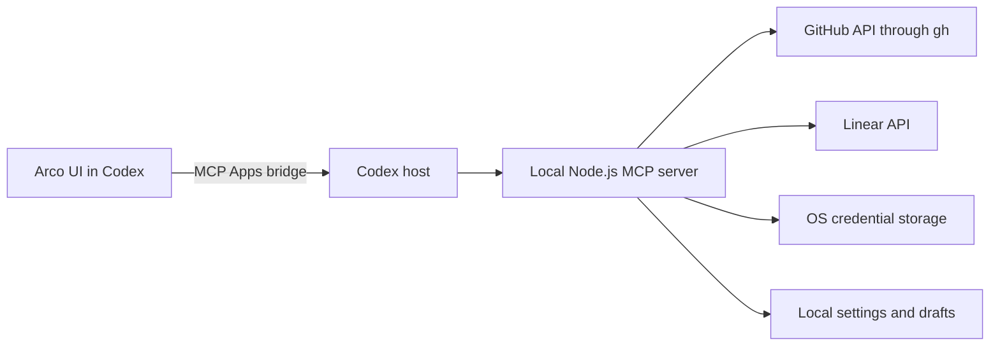

# Authentication and distribution

Arco is distributed as MIT-licensed source and a local Codex plugin built from that source. The current plan uses manual installation rather than official public-directory submission. See [Installation](installation.md) for the build and installation steps and [LICENSE](../LICENSE) for the project license. Third-party dependencies keep their own licenses and notices.

## Connection architecture



Arco has no hosted issue backend, independent login, or account database. A source account connected elsewhere in Codex does not automatically authorize Arco's process. The local server uses the connections described below; it does not inspect another plugin's credential cache.

## GitHub

Arco uses the public GitHub CLI (`gh`) and the account selected by that CLI. Authenticate with `gh auth login` and check the active account with `gh auth status`. Required repository and organization permissions depend on the requested operation.

GitHub Projects requires additional authorization. When a Projects operation reports a missing scope, the user can review and grant the `project` scope with:

```sh
gh auth refresh --hostname github.com --scopes project
```

Arco does not silently change CLI authorization or log out a shared CLI connection. Choosing repositories in Arco narrows browsing; it does not narrow the permissions already granted to the CLI.

The transport invokes `gh` with argument arrays and explicit API methods. JSON mutation bodies use standard input rather than shell interpolation. The account-list conditional cache obtains the current token through `gh auth token --hostname github.com --no-refresh` only to compute a private in-memory credential identity. Neither the token nor its hash is returned to the UI, model, or disk. This prevents a cached page from crossing credential changes, including token rotation for the same username.

GitHub CLI must support `--no-refresh`. Credential storage for GitHub remains the CLI's responsibility; Arco does not create a second persistent token store. See [GitHub CLI authentication](https://cli.github.com/manual/gh_auth_login) and [GitHub discovery](github-account-discovery.md).

## Linear

Linear uses a separately registered OAuth application. The setup UI accepts the application's client ID and uses this callback:

```text
http://127.0.0.1:53187/oauth/linear/callback
```

The implementation requires an HTTP loopback address on `127.0.0.1`, an explicit port, and the `/oauth/linear/callback` path. Register the exact URI used by the UI with Linear. The flow uses `actor=user`, `read,write`, PKCE S256, and state validation. It exchanges and refreshes tokens without bundling a client secret.

An application restricted to a private Linear workspace is not a ready-made connection for other users. Each deployment needs an OAuth client whose access settings permit the intended users, or users must register their own client. Do not treat the maintainer's historical test connection as a shared public credential. See [Linear OAuth documentation](https://linear.app/developers/oauth-2-0-authentication).

Access and refresh tokens are stored together in the OS credential store under `Arco Linear OAuth`. Linux uses Secret Service. An unavailable or locked credential store is an error; there is no plaintext fallback. Refresh reads and updates the token pair inside a connection-specific process lock.

**Disconnect Linear** removes Arco's local connection. Revocation is a separate option in the server API; do not describe local removal as provider-side grant revocation. Drafts, display settings, and existing Codex attachments remain separate from connection removal.

## Runtime and package boundary

The shipped manifests start `node` on the host's PATH. The development baseline is the version in [`.node-version`](../.node-version) and [`package.json`](../package.json). Arco does not depend on an undocumented host Node environment variable.

The build includes the locally installed native keyring binding and writes `runtime-platform.json`. Build separately on each target OS and architecture; an artifact built on one Mac is not a universal package. Only macOS arm64 has native validation evidence in this repository. See [Platform validation](platform-validation.md).

Official-directory eligibility is separate from source availability and manual installation. Documentation and release work should preserve the local architecture without adding a hosted MCP service solely for directory submission.

## Data and diagnostics

Provider credentials must not enter HTML, model-facing tool results, `_meta`, local settings/drafts, or ordinary diagnostics. Issue text reaches the source APIs, the local UI, and Codex when explicitly shared. Local execution does not imply that no data leaves the device.

See [Local data](local-data-boundary.md), [Security design](security-and-privacy.md), and [SECURITY.md](../SECURITY.md).
