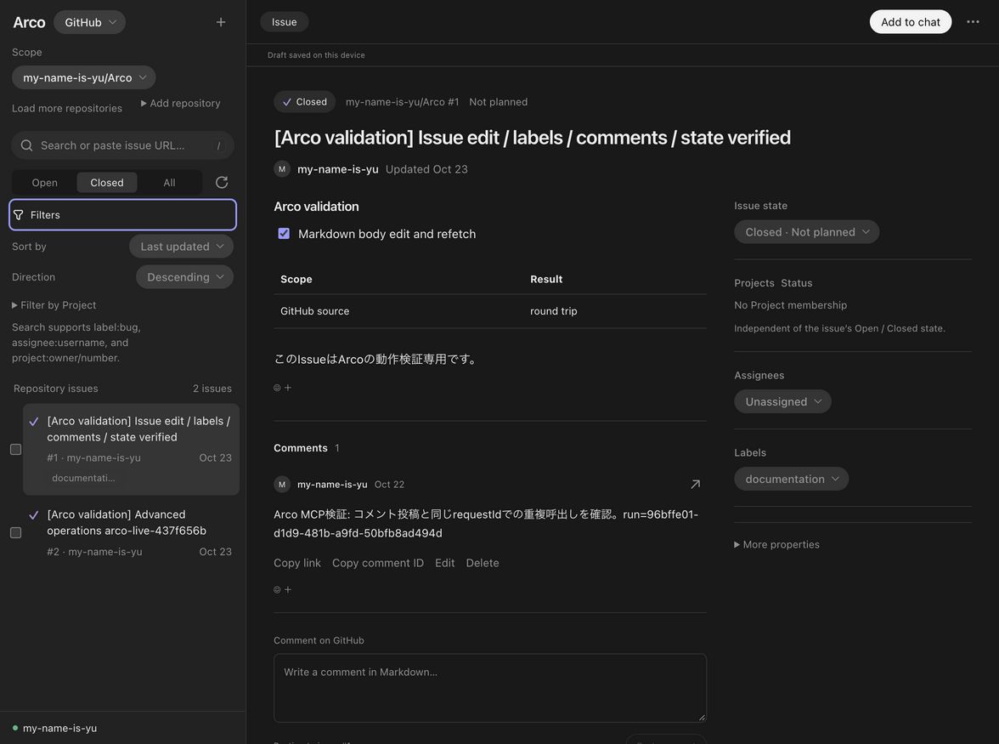
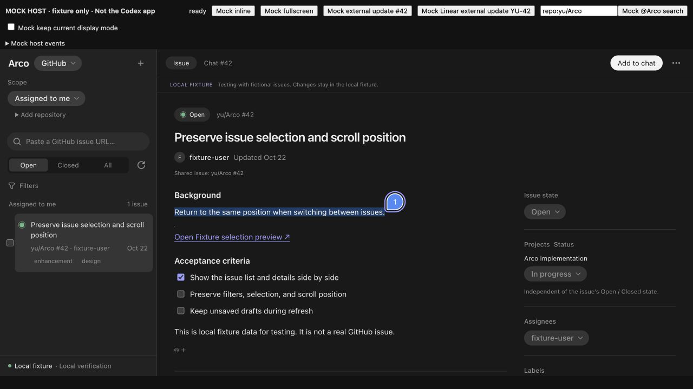
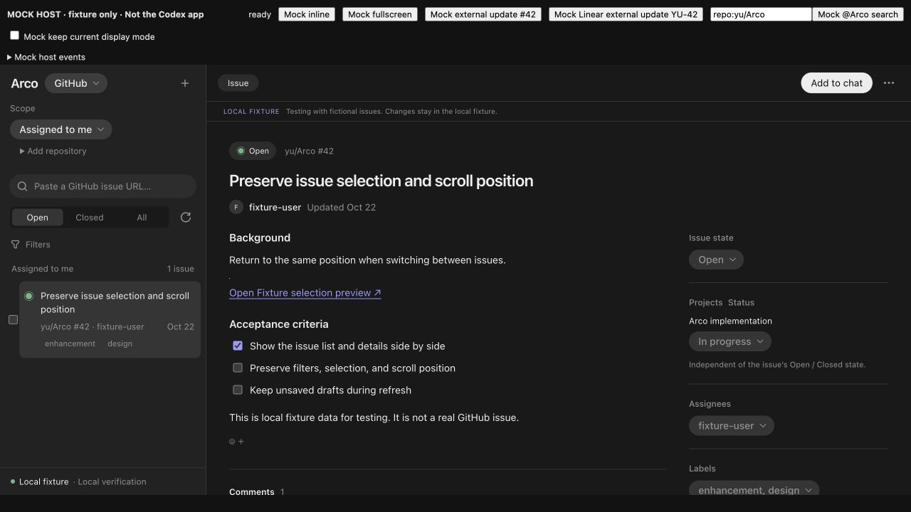
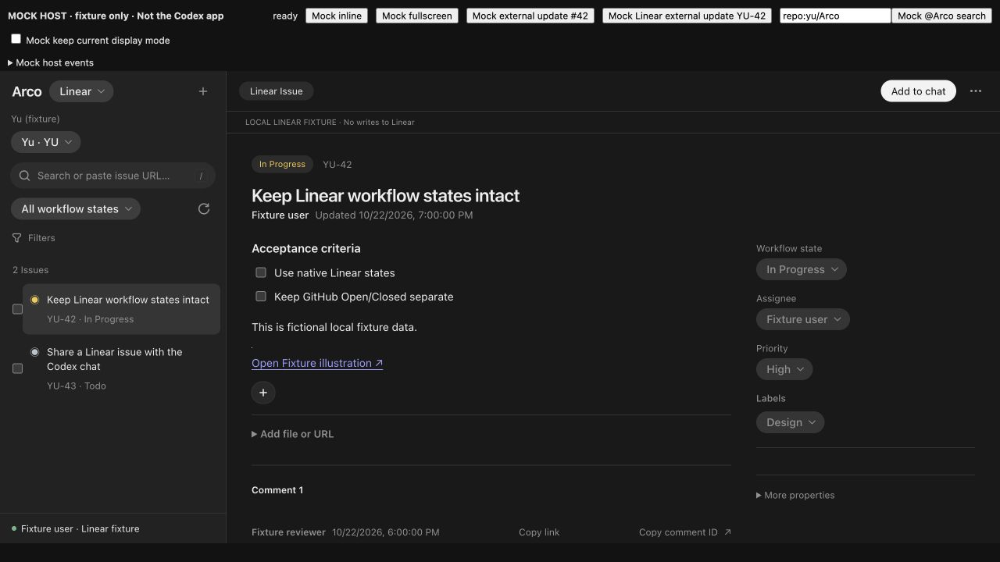
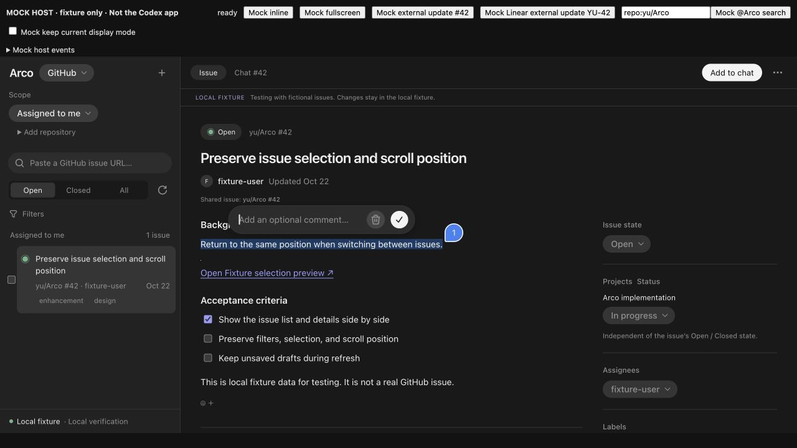
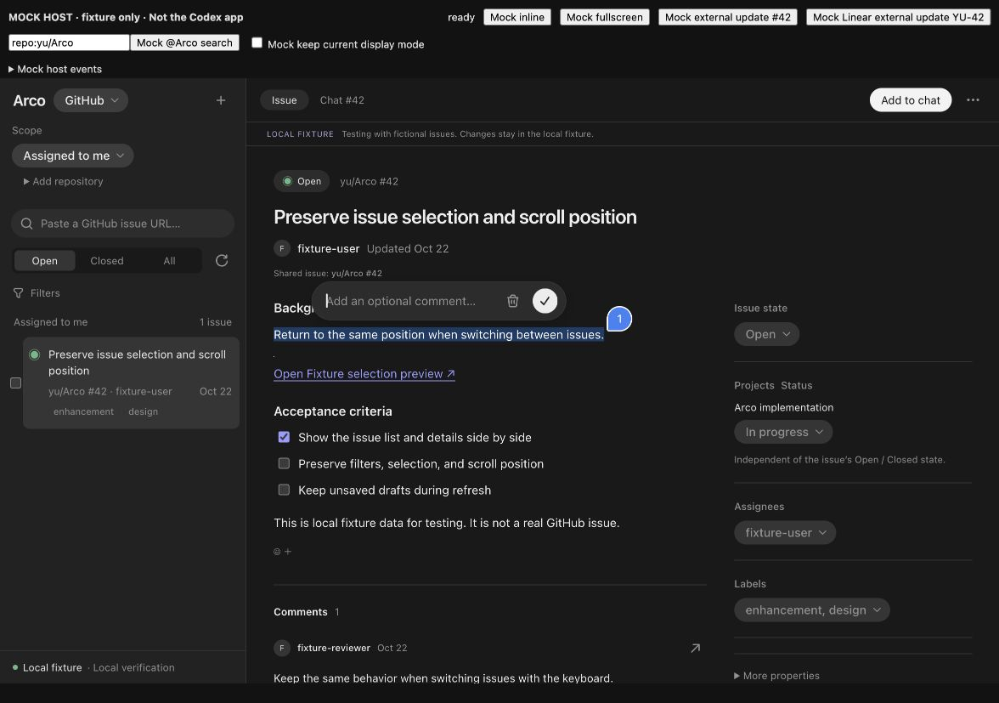
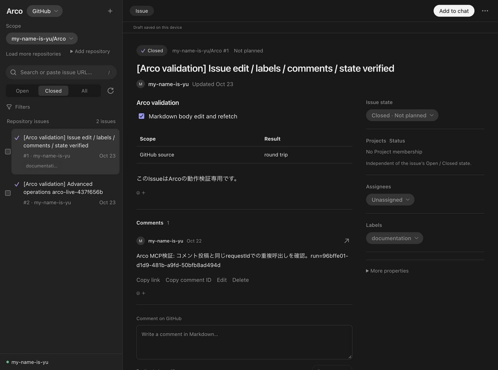

# ホバー拡大の統一と画面確認

確認日: 2026-10-23。macOS、Node 24.22.1。[色・枠のホバー統一](hover-validation-2026-10-23.md)に続き、録画を参考に実行・開閉する操作へ拡大を追加した。ユーザーの追加希望に従い、対象すべてを一律1.04倍・150msとした。

## 対象と保持する操作

- 注釈番号、アイコン操作、リアクション、削除できる属性チップ、作成・保存・投稿・共有・コピー・再試行・キャンセル・詳細表示・ページ送りなどの実行ボタン、操作メニューの項目を対象とする。SDKのButtonも含む。
- 折りたたみは見出しの文字・アイコンだけを拡大する。22箇所を共通の`DisclosureSummary`で包み、Linearの接続名は文字部分だけ包んだ。全幅の操作領域、接続dot、末尾アイコンの配置を保つ。icon-onlyのsummary 2箇所は操作面を拡大する。
- Source・Scope・属性などのSelect、Open/Closed/All、編集モード切替、checkbox、入力欄、Issue行、本文中のリンクは拡大しない。従来の色・枠の反応を保つ。
- layoutの寸法は変えず、視覚上だけ拡大する。注釈は左下の起点を固定し、本文・ハイライトを移動しない。離れると元の寸法へ戻る。
- disabled・loading・inert・非表示の操作を除外する。fine pointerだけに適用する。reduced-motionでは拡大とtransitionを止め、色の反応を保つ。

## 実画面での確認

最終buildをローカルpluginへ再installし、新しく開いたCodex内の実ArcoでGitHub検証Issue #1を表示した。Add to chatのtokenが`1.04`、transitionが`0.15s`となり、Filtersの開閉と既存の選択・本文・下書き表示を確認した。元サービスへの書込みや実会話への共有は行っていない。

同じbuildのfixture hostをin-app browserで表示し、実際のマウス移動で確認した。注釈はfixture内の本文をドラッグで選択して作成した。実会話への添付ではない。

| 操作 | 観測結果 |
| --- | --- |
| Add to chat | 幅96.546875→100.408691px、scale=1.04。layout幅97px・高さ28pxは不変。離脱後は元に戻った。 |
| 注釈番号 | 30→31.2px、scale=1.04。左下の起点と本文のrect・文字を保持。離脱後は30pxへ戻った。 |
| Filters | summary全体261×30pxは不変。内側の見出しだけ幅56.734375→59.003746px、scale=1.04。 |
| Source Select | 幅87.8984375px・高さ28px・scale=noneを保持。従来どおり選択メニューを開き、Linearへ切替できた。 |
| Linearリアクション追加 | 幅30→31.2px、scale=1.04。layout幅30px・高さ28pxは不変。 |

静止画は表示の記録であり、動きの確認にはマウス移動、transition途中と完了後のscale・寸法、離脱後の復帰も併用した。Codex内の反映・通常操作確認と、fixtureでのポインタ操作を分けて記録している。

## 自動確認と配布物

- `npm run check`: 型・lint、unit/adapter185件・21ファイル、build、68 tools smoke、artifact検査が成功。
- `npm run test:browser`: 全93シナリオが最終buildで一括成功（5.0分）。CSP違反・page errorも検査した。
- hover browser 6シナリオが成功。一律1.04、離脱後の復帰、全対象のlayout寸法保持、選択式の視覚寸法保持、disabled・reduced-motion・touch、注釈hover中のRange文字・rect・左下の起点保持を検査した。
- 最終format・diffの空白検査が成功。
- HTML: 1,626,048 bytes、SHA256 `7188696e5c942c0b329d815d78071a110d078f57540341515cc7ff3c2d30f026`。最終buildとinstalled cacheが一致。
- server SHA256: `5f83f4bafe8aa2d4fcaa6a391f9ed61dff5643089a8ef5c5d0ea431f2672ee59`。buildとinstalled cacheが一致。

## 追補: ゴミ箱と全操作の再点検

ユーザーの指摘を受け、3人のsubagentで操作要素の全体棚卸し、SDK・CSS・配布物の独立点検、browserテストの補強を分担した。次の数は画面の描画個数ではなく、現行TSXの定義箇所数。

| 対象 | 定義箇所 | 判定 |
| --- | ---: | --- |
| native button | 96 | 86対象。Issue行2・本文リンク3・選択と編集モード切替5は承認済みの除外 |
| SDK Button | 51 | 全対象。注釈のゴミ箱・保存を含む |
| summary | 25 | 見出し部分23・icon-only2を対象 |
| SingleSelect / MultiSelect | 45 | 選択式として拡大しない |
| input / textarea | 49 | 入力・選択領域として拡大しない |

SDKのMarkdownから生成されるコードCopyボタンもnative buttonとして対象となる。Selectのportal内は拡大しない。本文内の添付「Open…」「View original content…」も、本文リンクとして拡大対象外に保つ。backdropの閉じる処理とクリックのイベント委譲を除き、非buttonの実行操作が漏れているケースは見つからなかった。

fixtureの実画面で注釈を作り、ゴミ箱と保存ボタンを実際のマウス移動で再確認した。両者とも28→29.12px、SVGは18→18.72px、scale=1.04、transition=150msとなり、layout寸法は28pxのまま、離脱後は元へ戻った。確認用注釈のゴミ箱をクリックし、番号・ハイライト・編集UIが消えることも確認した。元サービスや実会話の注釈は変更していない。

Codex内には拡大追加前のArcoタブも残っており、Add to chatの`--arco-action-hover-scale`が空、transitionが色だけの`0.15s`だった。更新版のタブはtokenが`1.04`でscaleもtransition対象だった。最新版を新しく開き直し、token・transitionと実Issueの表示を確認した。既存の旧タブは閉じていない。指摘時にユーザーがどちらのタブを見ていたかまでは確定していない。

合意範囲の製品コードに拡大対象の漏れは見つからなかった。一方、前回のテストにはゴミ箱・保存ボタン本体の検証がなかったため、両者とメニュー・作成画面・削除チップ・inlineなどの検証を補った。倍率は一律1.04のまま。配布物とinstalled cacheのhashも上記から変わっていない。

- 補強後のhover 6シナリオがすべて成功（54.3秒）。状態別に延べ101回のhoverを確認した。
- 実際に表示されたnative button/summaryを列挙する監査は、GitHub workspace31・操作メニュー5・作成ダイアログ6の計42対象。意図的な除外も寸法保持を確認する。
- ゴミ箱・保存は通常の拡大・150ms・復帰・layout保持に加え、保存待ちのdisabled、reduced-motion、touchと実際のtapも確認した。
- 型・ESLint・format・diff空白検査が成功。製品コードと配布物は同一のため、直前の全browser93件の記録は保持し、今回の全93件再実行はしていない。
- 状態別の計測値は各`test-results/**/hover-feedback-samples.json`に保存した。

以上はcommit前に実施した検証の記録。
