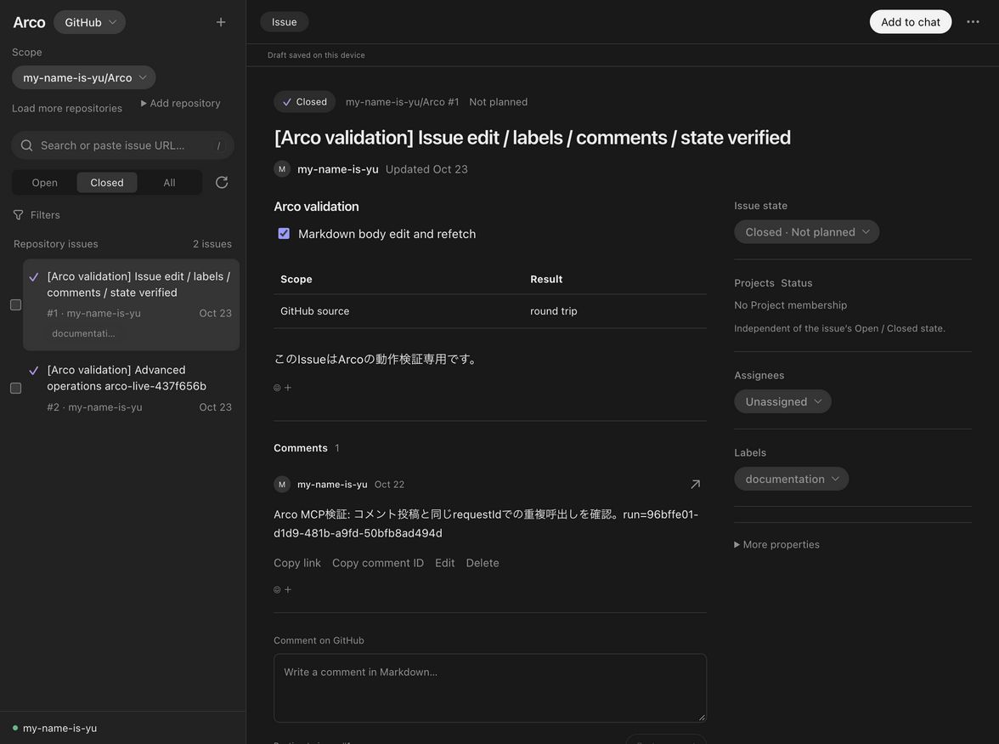
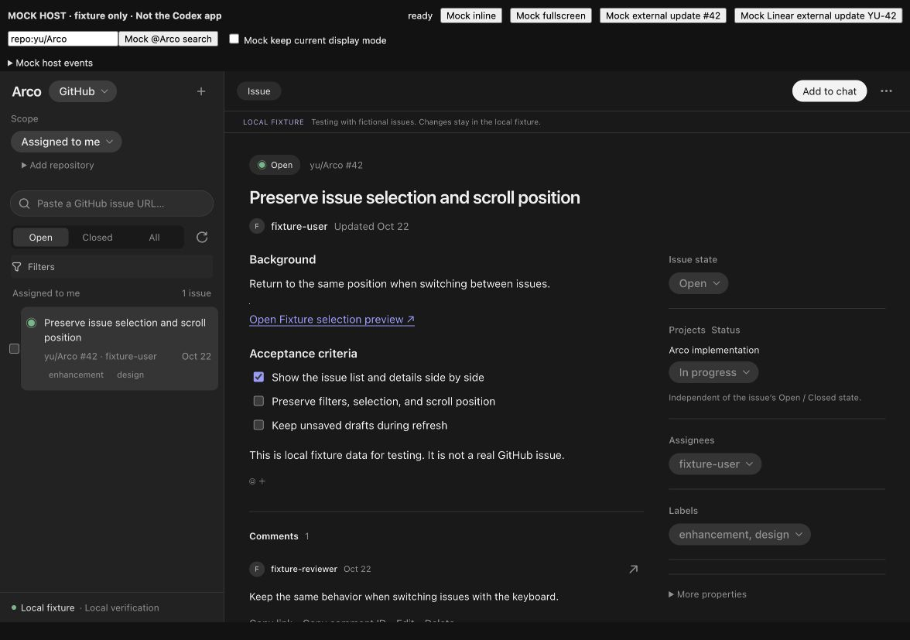
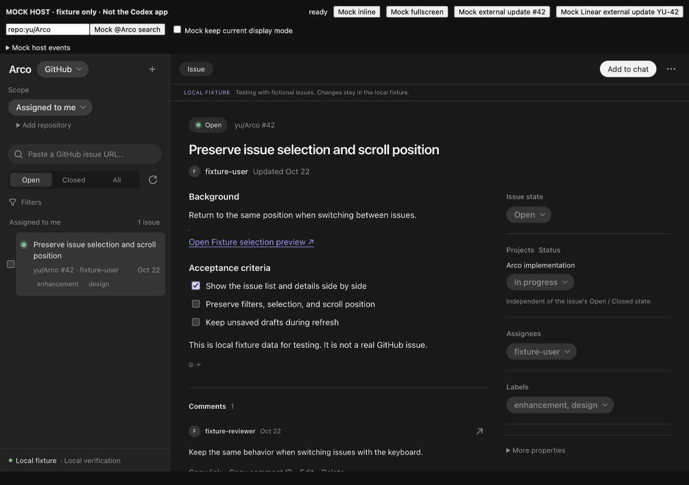

# 操作要素のホバー統一と画面確認

確認日: 2026-10-23。macOS、Node 24.22.1。[先行するアニメーション・スケルトンの確認](motion-loading-validation-2026-10-23.md)への追加変更。元サービスのIssue・コメントの書込みや、実会話への共有・送信は実行していない。

## 実装

- Arco独自のbutton・リンク・summary・role=buttonへ、150msの淡い内側の色変化を共通適用した。一覧行、状態切替、編集タブ、ページ送り、チップ、リアクション、本文リンク、注釈番号も対象。
- 入力欄・textareaは枠、checkbox・radioは小さなリングで反応する。検索欄と注釈コメントは外側の枠だけに適用し、二重枠を避ける。date・color・fileとfile-selector-buttonも対象。
- SDKのButton・Selectとportal内の選択肢は、既存の150msの反応を保つ。独自CSSを重ねて描画しない。
- ホバーで位置・寸法・選択色・値を変えない。本文と注釈の位置を保つ。focus outlineは維持する。
- disabled・loading・inert・非表示の要素を除外する。fine pointerのホバーに限定し、タッチで色が残らない。reduced-motionでは色は即時に変え、transitionを止める。
- 従来の個別hover指定を共通ルールへ集約した。既存の押下・表示・スケルトン演出は継続する。

## 実画面

配布物を再installし、新しく開いたCodex内の実ArcoでGitHubの専用検証Issue #1を表示した。状態切替に150msのtransitionと新しいhover tokenが入っていることをDOMから確認し、選択状態・本文・既存下書きの表示を確認した。

同じbuildのfixture hostをin-app browserで開き、実際のマウス移動で状態切替・Filters・検索欄・チェック済みMarkdown項目をホバーした。transition途中の色・枠の変化をDOMでも観測し、選択・checkedを維持することと、位置が動かず反応が控えめなことを確認した。以下はfixture画面で、元サービスのデータではない。

静止画は配置と反応の見た目の記録であり、時間変化の確認にはマウス操作・transition値・変化途中の描画値を併用した。Codex内の反映確認と、fixtureでのポインタ操作を分けて記録している。

## 自動確認と配布物

- `npm run check`: 型・lint、unit/adapter185件・21ファイル、build、68 tools smoke、artifact検査が成功。
- `npm run test:browser`: 全93シナリオが一括で成功（4.7分）。先行するloading/interaction87件と、追加hover6件を含む。CSP違反・page errorも検査した。
- 追加したhover browser 6シナリオが成功。GitHub/Linearの操作種類、SDK、選択済みの背景・文字色、状態・値・寸法の保持、disabled、file/date/color、注釈番号・コメント枠、light・reduced-motion、keyboard focus、touchを含む。
- 最終のformat・lint・diff空白検査が成功。
- HTML: 1,624,642 bytes、SHA256 `07c13aef8cbaea0c5d67ed215b010aba7746a31e8ed5100903e9c220682e35f3`。最終buildとinstalled cacheが一致した。

以上はcommit前に実施した検証の記録。
