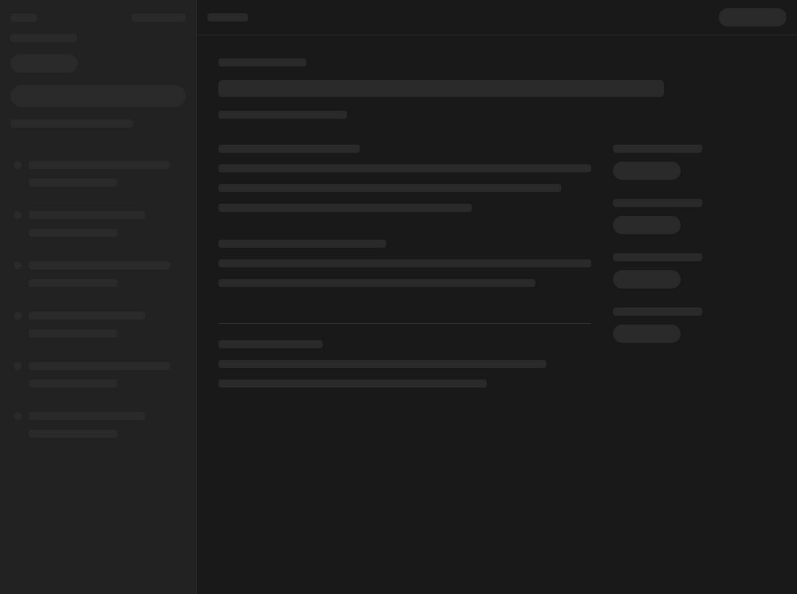
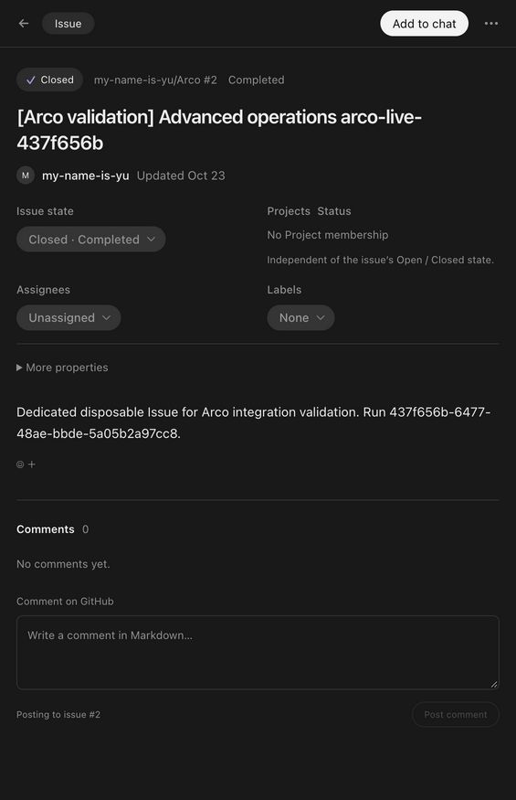
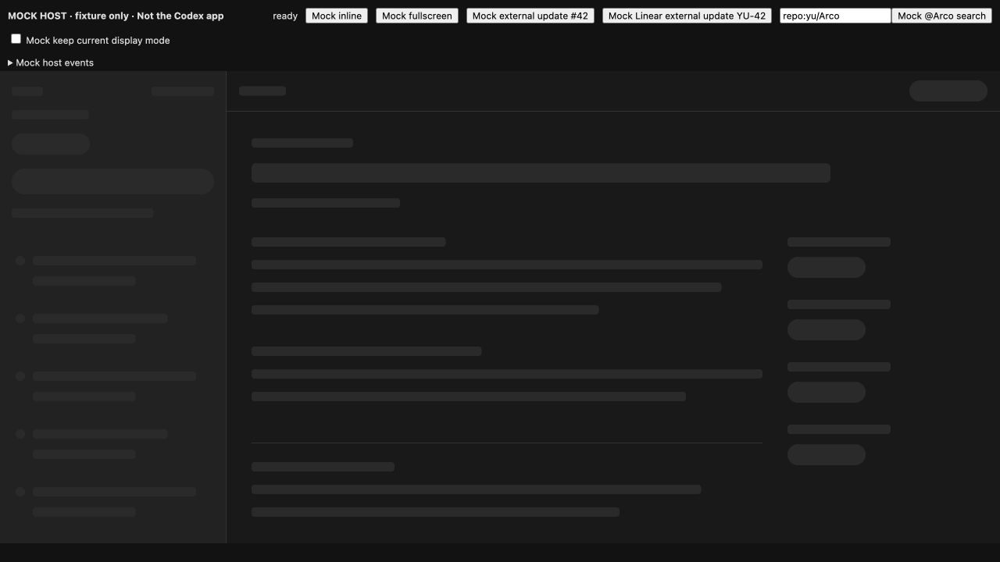
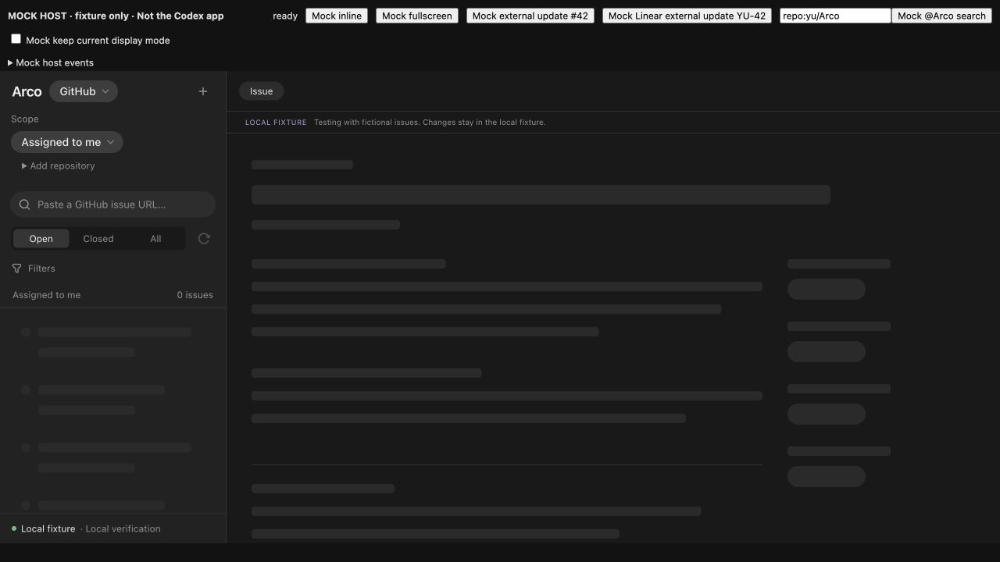
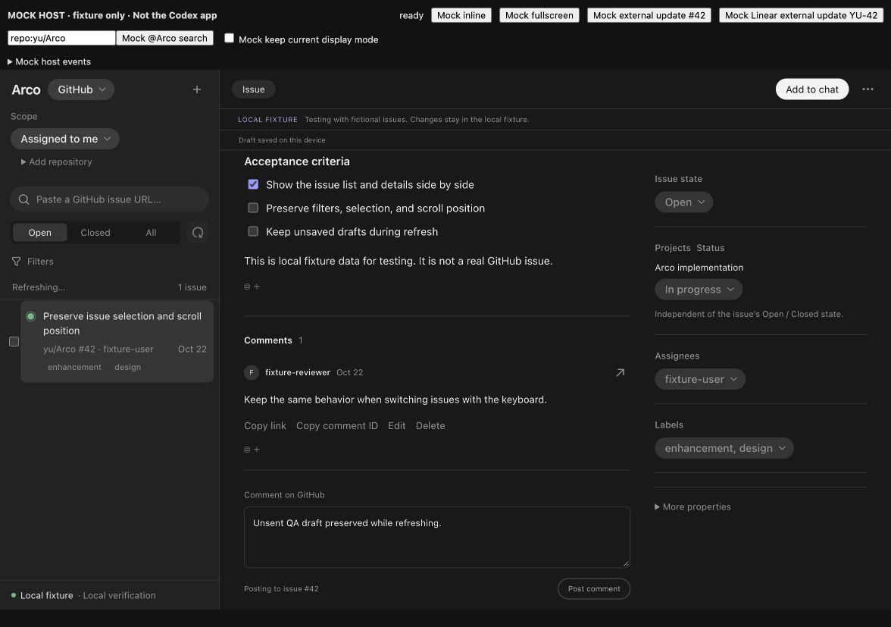
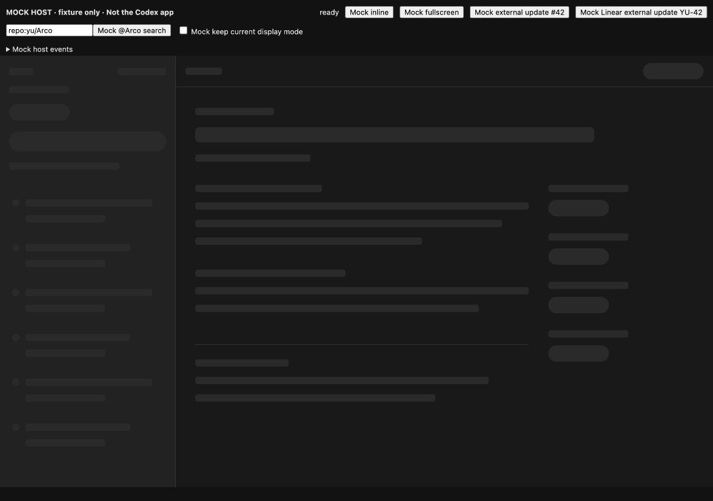
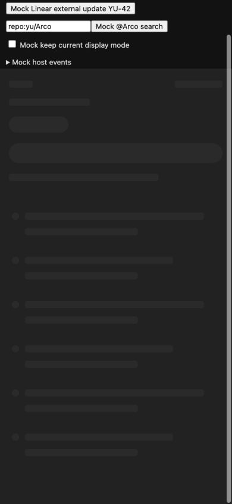
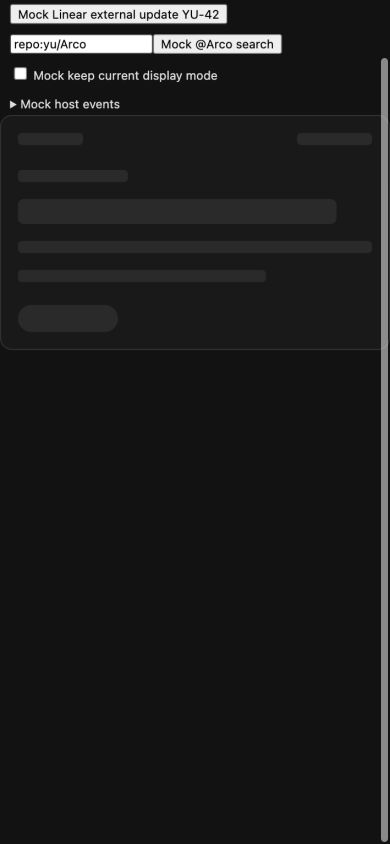

# アニメーションとスケルトンの実装・確認

確認日: 2026-10-23。macOS、Node 24.22.1。元サービスのIssueやコメントへの書込み、会話への共有・送信はしていない。

## 実装

- HTMLの初回表示、host接続、設定・sourceの確定、初回connection/scopes取得を全画面スケルトンでつなぐ。接続確認中と未接続を分ける。
- host接続前は現在のiframe viewport内に収め、通常workspaceの最小高さを適用しない。inlineで開いた小さな領域を起動時に縦へ広げない。
- 一覧・詳細・会話内カードに専用のスケルトンを用意した。一覧が使える時点で表示し、詳細だけ遅い場合は詳細の骨組みを残す。
- 定期更新や手動更新では読み込み済みの本文・入力を保つ。空一覧・未接続・取得失敗はスケルトンから抜け、Linearのteam取得失敗はRetryできる。
- 行のhover・選択、独自ボタン、状態切替、詳細、コメント、編集、折りたたみ、通知、共有UI、一括操作へ120〜200msの動きを付けた。本文と注釈の祖先を移動せず、SDKのSelect/Buttonへ押下やメニューの動きを重ねない。
- 作成ダイアログは背景フェードと4pxの移動。閉じると140msの退出を行い、退出中はinertとする。フォーカスを起点へ戻し、退出中の再オープンでも内部へ移す。
- prefers-reduced-motionではSDKのportalも含むArco文書の動きを止め、スケルトンを静止させる。ダイアログの退出待ちも省く。

## Codex内の実Arco

配布物を`codex plugin add arco@arco-local --json`で更新し、新しくArcoを開いた。buildとinstalled cacheのHTML/server SHA256が一致した。

1. GitHubの専用検証Issue #2を開き、詳細のスケルトンから本文へ移ることを確認。詳細のanimationは`arco-reveal / 0.18s`、行のtransitionは`0.12s`で、workspaceのtransformはnoneだった。
2. Issue actionsメニューを開閉し、`arco-rise / 0.15s`の反映と通常操作を確認。
3. Linearへ切り替え、`Checking Linear connection`の全画面スケルトンからYu teamの実一覧とYU-49の本文へ移ることを確認。
4. Linear作成ダイアログを開き、`arco-rise / 0.2s`と内部へのfocusを確認。Close後は起点のCreate Linear Issueへfocusが戻り、退出中はclosed、退出後にbackdropが消えた。作成は実行していない。
5. GitHub表示へ戻した。

静止画だけを動きの証拠とはしていない。画面操作とDOM上のanimation/transition、表示状態を併せて確認した。実hostの通信に人工的な遅延は加えていない。

## 遅い通信・狭幅・動きを減らす設定

fixture専用hostへ`ARCO_DEV_TOOL_DELAY_MS=2000`を指定し、MCP tool応答を2秒遅らせて、in-app browserで実際に表示・操作した。この遅延は開発用hostだけの機能で、配布物には含まれない。

| 場面 | 観測結果 |
| --- | --- |
| 初回 | Arco領域全体のスケルトンが表示された。1280px幅の確認では1280×605pxで、host接続後の設定待ちも覆った。 |
| 一覧待ち | 接続済みの操作欄を先に表示し、一覧と詳細だけ骨組みを残した。誤った空状態の案内は出なかった。 |
| 手動更新中 | detailのaria-busy=true、スケルトン0件。本文と未送信コメントをそのまま表示し、Refreshingを示した。更新後も同じ下書きが残った。 |
| reduced-motion | スケルトンのafter要素がanimation=none、display=noneとなった。OS自体の設定は変えていない。 |
| 狭幅 | 390pxで横方向のはみ出しなし。初回は一覧用の形を表示した。 |
| inline | 同じ390px幅で235px高のカード形状となり、全画面の高さを持ち込まなかった。 |

## 自動確認と配布物

- `npm run check`: 型・lint、unit/adapter185件・21ファイル、build、68 tools smoke、artifact検査が成功。
- browser87項目を確認。全体実行で85件成功。旧ローディング文言を前提にした2件は、inlineスケルトン・busy状態・失敗後の消去を確認するassertへ更新し、対象2件の再実行で成功した。初回分岐、エラーとRetry、両sourceの更新中の下書き保持、reduced-motion、ダイアログのEscape・focus・退出中の再オープンを含む。
- format、最終lint、diffの空白検査が成功。CSP違反・page errorはbrowser検証で検査した。
- 最後に接続前のbootstrapを390×180pxのJavaScript無効画面でも確認し、最小高さによるはみ出しを防いだ。
- HTML: 1,620,584 bytes、SHA256 `e8a6050f8eb0b45e099b05258997537c91b455e189f9be5fecc77e60418a5ac2`。最終buildとinstalled cacheが一致した。
- server SHA256: `5f83f4bafe8aa2d4fcaa6a391f9ed61dff5643089a8ef5c5d0ea431f2672ee59`。

実サービスのIssue作成・編集・共有payloadの再確認や、全アクセシビリティ適合の認定は今回の範囲に含めていない。以上はcommit前に実施した検証の記録。
