# Arco UI comparison — 2026-10-23

対象はIssueを選び、本文を読み、属性変更や会話への共有へ進む流れ。1〜4は配布HTMLをfixture専用のMCP Apps mock hostで確認した画像で、実サービスのデータを含まない。5以降は展開された実CodexのArcoを公開DOM経路で確認した記録である。

## 1. Narrow issue detail

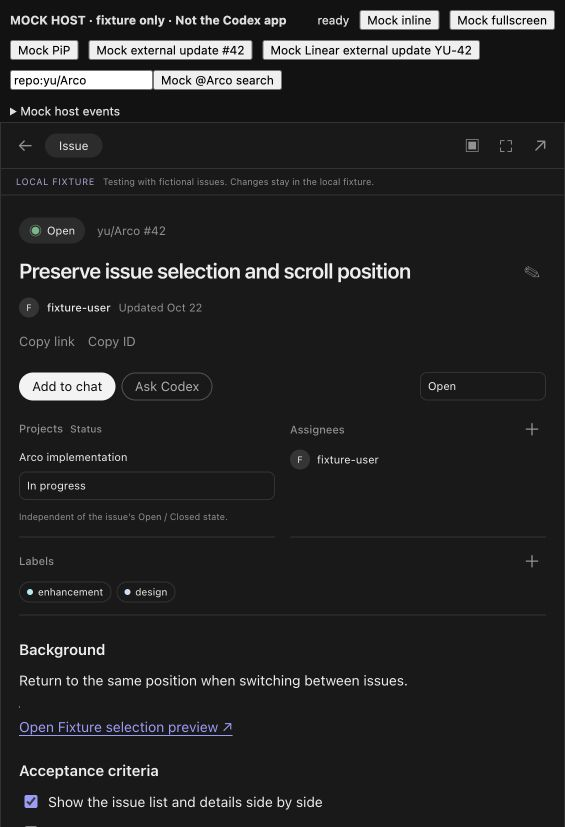

本文は読めるが、その前に表示操作、識別情報、コピー、共有、状態、属性が積み重なっている。PiP等の表示操作は記号だけで、主要操作と補助操作の区別も弱い。ユーザーは実CodexでPiPの操作を見つけにくかったと報告している。

改善は上部の一つの操作バー、静かな識別情報、コンパクトな属性のまとまり。補助操作をメニューに集め、共有と依頼は明示したままにする。ボタンを隠して機能を削る対応はしない。

## 2. Wide issue workspace

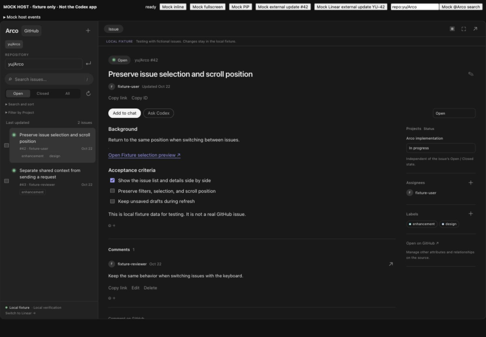

一覧・本文・属性の分離は既に機能している。一方、選択中repoがタブと常設入力欄の両方へ現れ、source切替も上部とfooterに重複する。検索の下には複数の補助設定が並び、詳細の操作も上部と本文下へ散らばる。

改善はsource・対象選択・検索・一覧という左側の順序を明確にし、sortとProject条件を一つのFiltersへまとめること。初期一覧は接続済みアカウントのAssigned to meを自動取得し、Created by me・Mentioned me・All account repositoriesは明示的に切り替える。repo選択は自動取得した候補による任意の絞込みにする。空の個人一覧から全repoへ勝手に広げない。本文・コメントは中央、属性と追加編集は右側に集約する。

## 3. Reorganized GitHub workspace

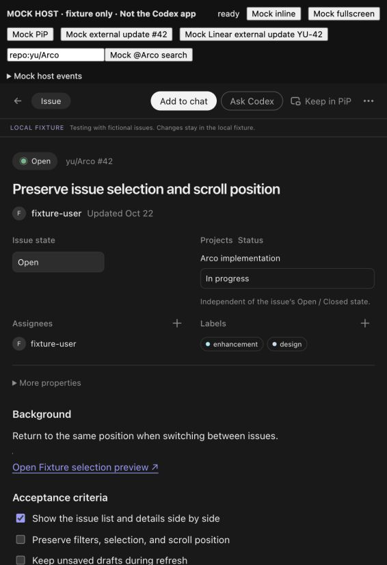

同じ1440×1000と566×826のviewportで再撮影した。主要な共有と依頼を上部へ、補助操作をIssue actionsへ、追加の属性操作をMore propertiesへ集約した。repoの常設入力と重複するsource切替を取り除いた。PiPは文字と標準SDKのiconで識別できる。本文が見える範囲と、操作の所在の一貫性が改善した。

個人向けの入口と広い範囲を分ける方針は、[Code Reviewのpersonal inbox](https://learn.chatgpt.com/docs/code-review)と[Linear My Issues](https://linear.app/docs/my-issues)を確認して採用した。[Linear Inbox](https://linear.app/docs/inbox)は通知を扱い、Issueの個人一覧とは分かれる。Linearの起動時homeは[個人設定で変更できる](https://linear.app/docs/account-preferences)。ArcoにLinearの通知基盤を追加するものではない。

## 4. Account and Linear views after reorganization

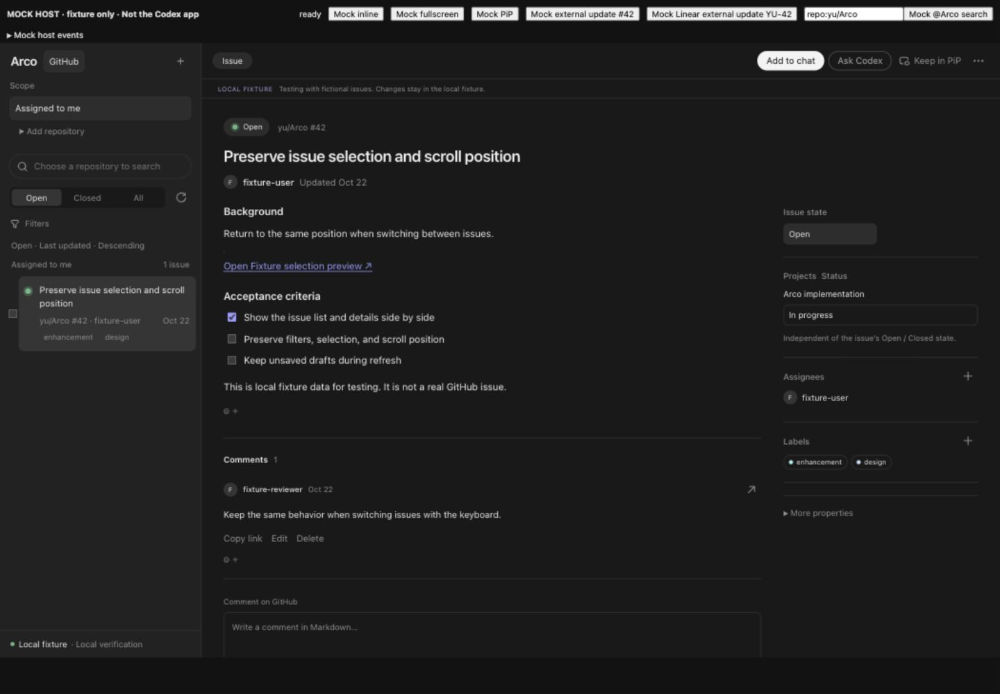

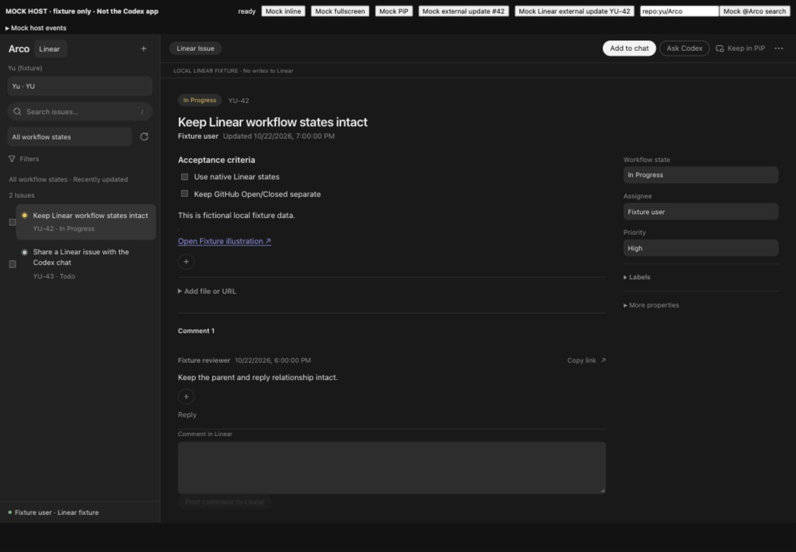

この段階の配布HTMLでGitHubのAssigned to meとLinearの詳細を再撮影した。GitHubはrepo未指定のままアカウント一覧と詳細を表示する。Linearでは使用されていないリアクションの列を折りたたみ、Issueと各コメントの追加ボタンから選択する。主操作は上部、状態・担当・優先度は右列に揃え、本文の前へ追加の設定を積み重ねない。

撮影後にIssue URL直接オープンと共有payload・依頼後の共有先保持も修正し、142件のunit/adapter、65 toolsのstdio smoke、artifact検査、42件のbrowserテストが成功した。操作メニュー・focus復帰・view再作成・リアクション選択・PR-onlyページの継続を含む。fixtureの成功と、実Codexの選択共有・PiP復帰の受入確認は区別する。

## 5. Expanded real Codex Arco

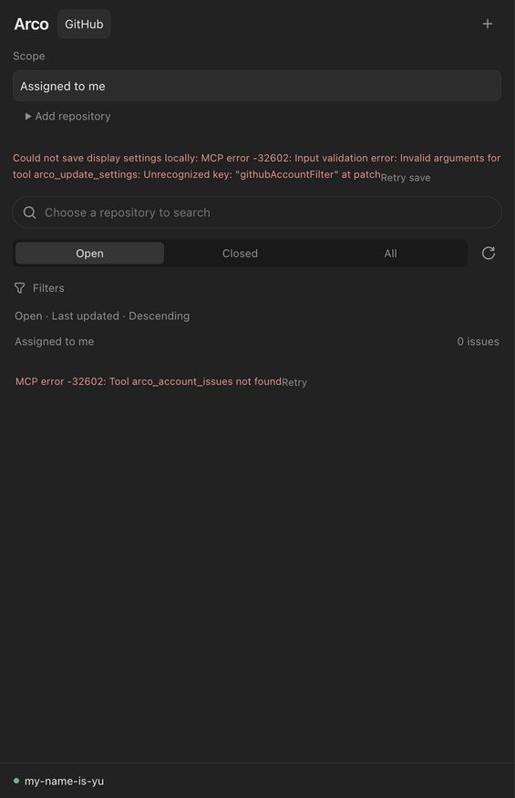

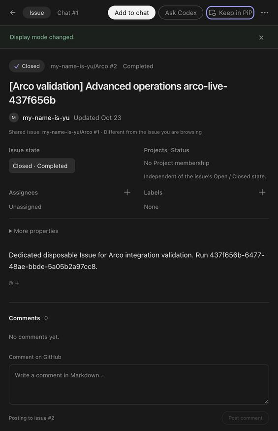

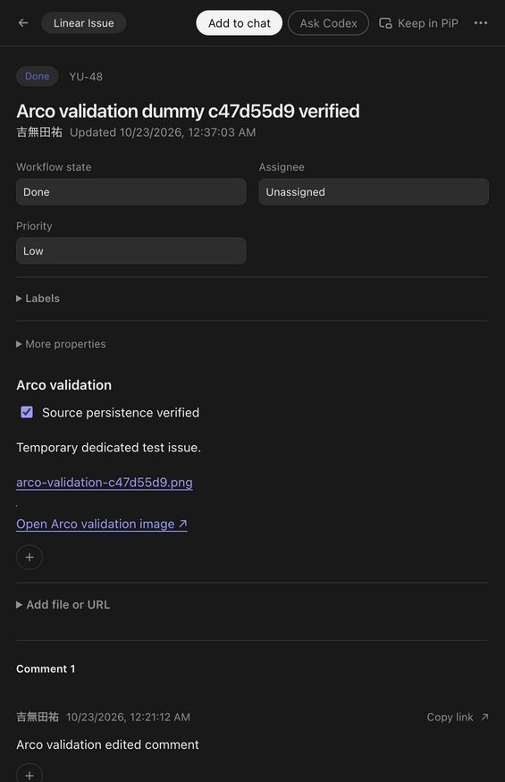

ここからはmockではなく、このチャットで展開した実ArcoをComputer Useの`mcpapps`経路から確認した画像である。新しいScopeとtoolbarが表示され、GitHub #1の明示共有後に#2を閲覧しても共有先の表示は#1を保持した。LinearではYu teamの一覧と専用YU-48の本文・コメント・認証付き画像を表示できた。

ただしaccount一覧は旧desktop serverのtool未登録エラーとなった。HTML更新だけでは既に起動しているserverの登録は更新されない。最終install後の再起動と再取得を残す。新規chatのPrepare draftはhost成功通知までで、composer確認は未実施。その後のSend試行はComputer Useがtimeoutし、成功も失敗も断定せず再送していない。元のpanelから別PiP領域は見えず、PiP復帰と選択範囲のモデル受信も未確認である。

## 6. Account discovery after restart

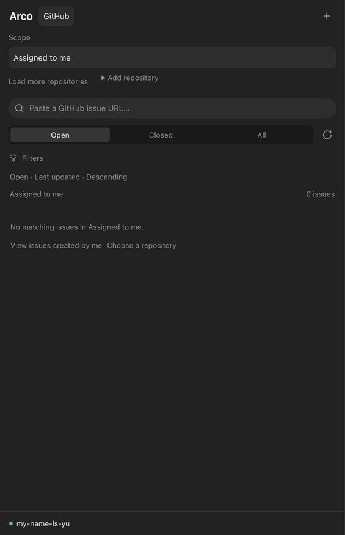

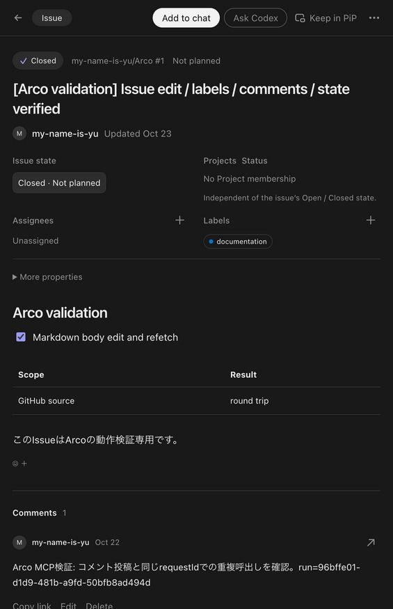

ユーザーのアプリ再起動後、new tool未登録とsettings schemaのエラーは解消した。Assigned to meは0件の個人一覧を表示し、勝手に全件へ広げない。Created by meを明示選択すると23件と次ページ操作を表示した。候補repoも自動取得できた。account scopeからRepository or URL欄へ専用GitHub #1のURLを入れると、正しいrepo・番号のClosed Issue本文が開いた。sourceデータへの書込みは行っていない。

同じ実画面で#1を明示共有し、#2の閲覧へ移っても共有表示は#1を保った。Keep in PiP要求後の元panelは詳細表示のままだった。この後、ユーザーがPiPを不要と判断したため、小窓側の調査・受入確認は終了した。会話内カードはinlineとして保持する。

## 7. PiP removed from the product scope

2026-10-23、ユーザー希望に従いPiPの操作・専用描画・スタイルとresourceの表示宣言を削除した。上記1〜6の画像に残るPiP操作は過去の状態であり、現在の製品仕様ではない。会話内カード（inline）、詳細（fullscreen／会話横）とglobal/threadの入口を引き続き対象とする。

共有Issueをカードに保持し、Open detailsで同じ対象へ戻る回帰確認はinlineへ移した。hostがfullscreen要求にinlineを返した場合は、実際のmodeを保持し、成功通知を出さず英語のエラーを表示する。GitHub／Linearそれぞれで拒否と再試行のfixture確認を追加した。

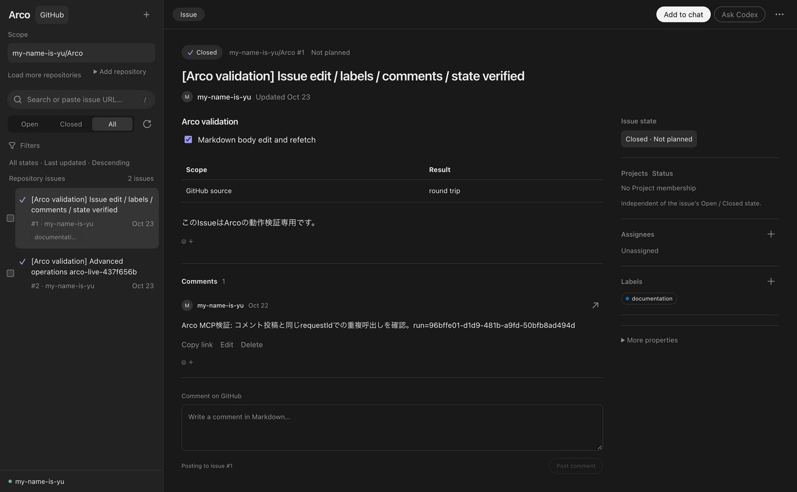

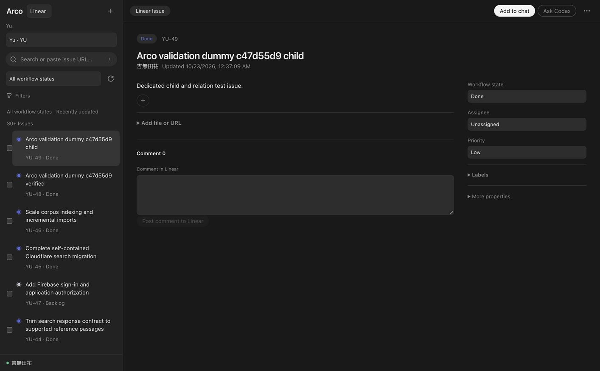

PiP削除版をbuild・install後、新しく開いた実ArcoのGitHub #1とLinear YU-49で、上部のPiP操作がなくなったことを確認した。sourceデータは変更していない。142件のunit/adapter、65 toolsのstdio smoke、artifact検査、44件のbrowser確認が成功。Linearの拡大ボタンもOpen detailsと同じ復帰処理へ揃え、その後の対象browser確認も成功した。

## 8. Native body selection delivered to the model

2026-10-23 11:59 JST、実GitHub #1のShare selection後、Arco由来のmodel_contextをこのチャットで受信した。選択文は「Markdown body edit and refetch」、originはbody。text内のsource contextとstructuredContentのselectionが一致し、両方とも本文全体を含めていない。ユーザーの返信は「共有した」のみだった。画面の成功通知やスクリーンショットだけではなく、実際の受信payloadを根拠とする。

この確認はGitHub本文の範囲共有に限る。コメントの範囲共有、Linearの範囲共有、inline復帰、composer mention、draft/sendはそれぞれの実機確認を残す。

その後、GitHub #1のIssue全体も同じArco由来model_contextで受信した。本文・ラベル・状態とnative識別子が含まれ、selection fieldはない。コメント共有の受信とは区別する。直前のコメント共有試行では、モデル受信と実画面のpreviewが両方とも前回のBody selectionのままであり、コメント範囲の成功には数えない。

## 9. Replace stale ranges when selecting a comment

コメントの余白などでmouseを離すと、範囲の再取得を省略する条件により前の本文範囲が残る問題をローカルで再現した。GitHubで本文からコメントへの置換、空選択、本文とコメントをまたぐ範囲の3ケースが修正前に失敗した。両sourceでcontent内のmouseupごとにrangeを検証し、選択解除だけのボタンはClear selectionへ改名した。

修正後の関連browser9件と、142件のunit/adapter・build・smoke・artifact検査が成功した。新しい会話への依頼と共有対象の保持、view再作成の回帰も含む。ユーザーの直前のnative操作が同じ原因だったとは断定せず、コメント選択のモデル受信を別に残す。

その後アプリを再起動して検証を再開し、実GitHub #1のコメント選択がこのチャットのArco由来model_contextへ届いた。originはcomment、native commentIdは`IC_kwDOVTZAxs8AAAABehqhtQ`。textとstructuredContentの選択文が一致し、Issue本文のbody fieldはない。GitHubのコメント選択はモデル受信まで確認済みとなった。Linearの共有、inline復帰、mention、draft/sendの残りの受入確認とは区別する。

## SDK multi-value menus

ユーザーの指定は担当者・ラベル等の複数選択メニューだけに適用する。GitHubの担当者とラベル、Linearのラベル、GitHub複数選択fieldに、導入済みSDKの `Select multiple` を使った。単一選択・boolean・一覧のbulk対象選択は変更しない。SDKの標準check、pill、popup、検索を使い、各sourceの属性と保存方法を保持する。候補から消えた既存値もdisabledの選択済み項目として保持する。

新しく開いた実Codexで、GitHub #1のdocumentationのcheckと、Linear YU-48のラベル候補を確認した。これはfixtureの画像ではない。元Issueへの追加書込みはなく、複数項目の変更・失敗・再試行とkeyboard/focusの検証はfixtureに分ける。SDKのEscape後のfocus復帰を補い、トリガーにfocusがある間は一覧のj/kや検索shortcutへ流さない。

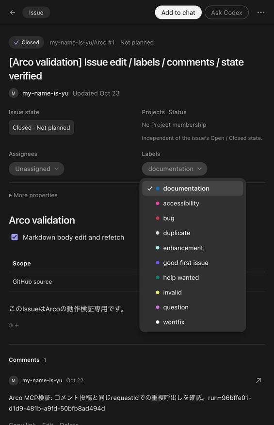

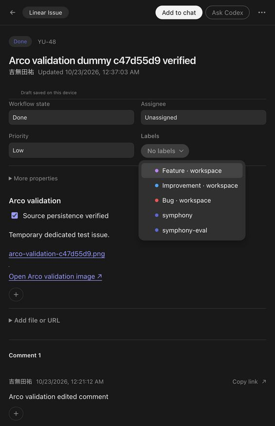

## All dropdowns

Source切替・Scope・Teamも含めて残り43箇所を共通 `SingleSelect` へ変更し、ネイティブのselectをなくした。単一選択と複数選択の意味は保持する。候補グループと検索、disabled、空の解除値、元のID、同値再選択のno-opを確認した。SDK内部の値だけ安全な非空IDへ変換するため、引用符・バックスラッシュを含む元ラベル名もそのまま保存できる。作成dialogのpopupをフォームより手前に置き、Escapeはpopupだけを閉じてトリガーへfocusを戻す。

全browser53件とCSP/page error、unit/adapter142件、型・lint・format・build・stdio smoke・artifact検査が成功。下の画像は最新buildのfixtureで、実Codexの反映証拠ではない。install後に新しく展開されたnative tab 4では旧Source／Scopeが残り、ユーザーも旧表示を確認した。Codex再起動後の表示確認を残す。

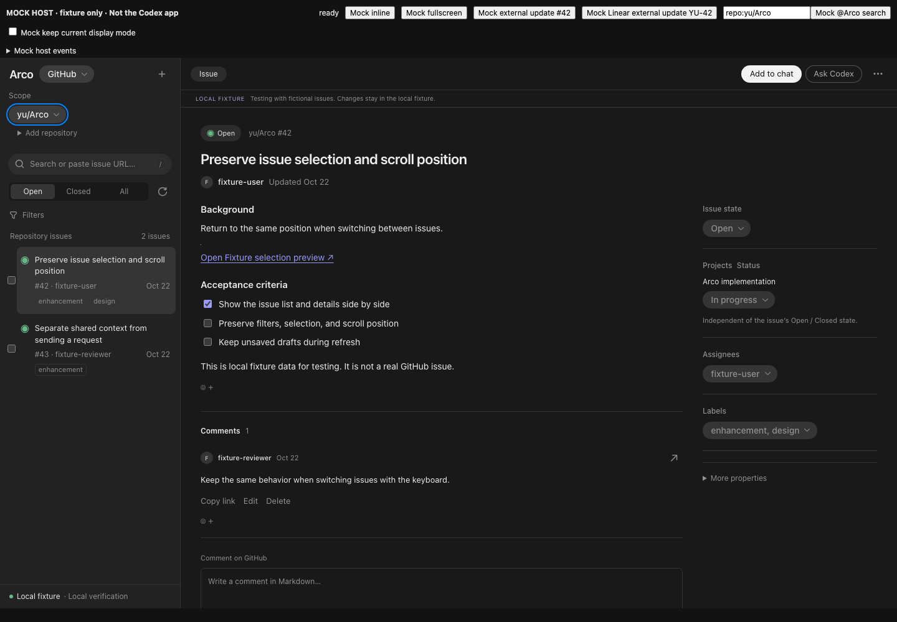

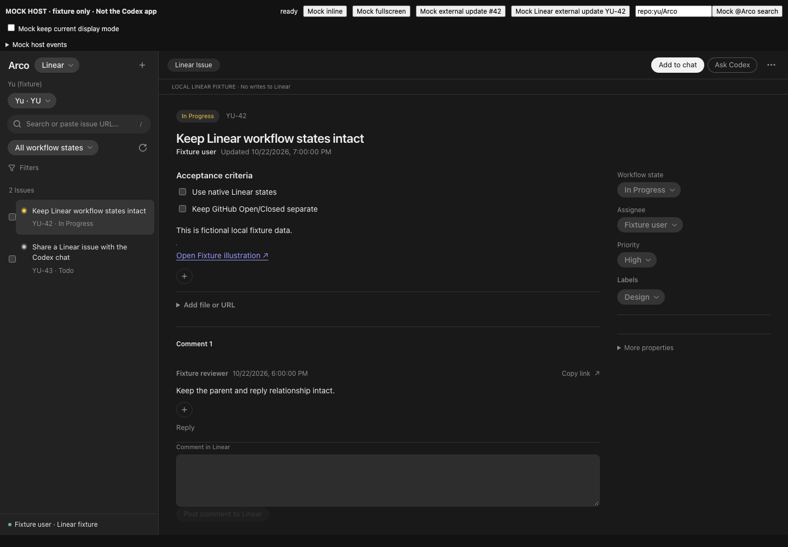

## Request queue overflow

ユーザーの13:04の実Codex画像ではSource／Scope／Issue stateに新しいpillが反映されていた。一方で `App server request queue is full` が設定・一覧・詳細・属性・リアクションに出ており、読み込み済みの本文の上へ大きな初回エラー画面も重なっていた。

fixtureでサイズ・テーマ通知を26回送ると、修正前はtool呼出しが11件から205件へ増えることを再現した。表示の変更をすべて全queryの再取得へつなぐ処理と、再取得の論理cancel後も古いRPCが残る組合せがあった。SDKの通常のcallServerTool応答だけでtool-result通知が自動発火するわけではない。実hostの通知列自体を採取したという意味ではなく、実エラーにつながる増幅経路をfixtureとコードで確認した。

表示とデータの通知を分け、サイズ・テーマ・表示modeでは元データを再取得しない。データ通知は100msでまとめ、選択中sourceのqueryだけを更新する。通知による再取得中の処理は重ねて開始しない。toolと画像のRPCは同時2件までとし、書込みを自動再送しない。両sourceの詳細は更新に失敗しても読み込み済みの本文と下書きを維持し、小さな通知とRetry refreshを表示する。

修正後の全browser57件とCSP/page error、unit/adapter145件、型・lint・format・build・stdio smoke・artifact検査が成功した。制限付きhostでは表示通知の追加tool呼出しが0件、同時2件以下、拒否0件で、外部Issue更新は1回の読取りで反映された。GitHubとLinearのcached detail・未送信コメントを保持して再試行できることも確認した。配布物はinstall済みでhashが一致する。修正版の実Codex反映はアプリ再起動後に確認する。

その後ユーザーから、Codexを再起動し「今回は大丈夫だった」との報告を受けた。これは実画面のユーザー報告であり、実hostの通知列や通信数を計測した記録ではない。

幅・高さ・テーマの変更は表示だけに反映し、元データの再取得、設定保存、会話への共有・送信、下書きの初期化を起動しない。会話内カードと詳細の明示的な切替では構成やpolling対象を変更でき、保留中のローカル下書きは保存するが、providerへの書込みは行わない。

表示領域の実変更も回帰確認へ追加した。GitHubでは5種類、Linearでは6種類のviewportを使い、各サイズでテーマ・寸法通知を連続送信した。入力済みコメントを端末へ保存して通信が落ち着いた時点を基準とし、表示変更後の全tool呼出しが増えないこと、Issueと未送信コメントを保持すること、共有・送信が発生しないことを確認した。制限付きhostの既存確認を含む対象browser3件、型・対象lint/formatが成功した。今回の変更はテストと確認記録のみで、配布UIは変更していない。

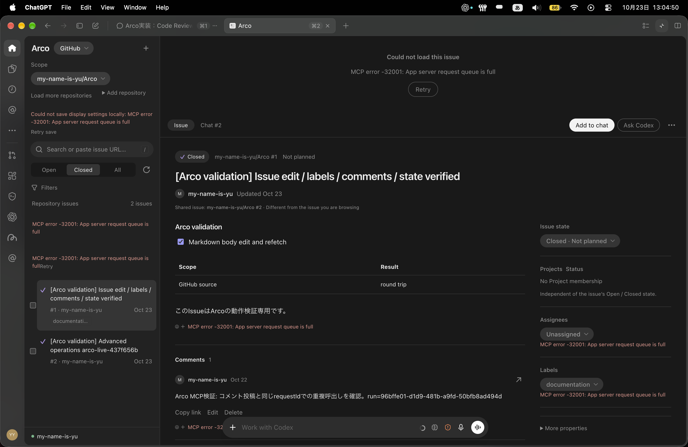

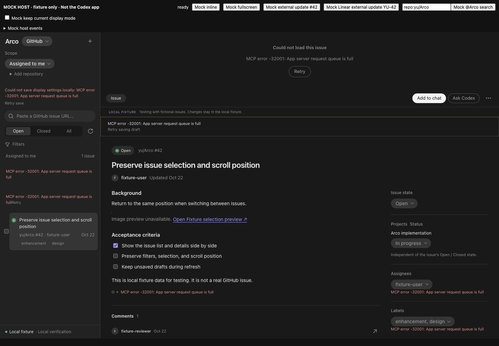

## Linear whole-Issue context received

実ArcoのYU-48でAdd to chatを実行し、通常の会話入力欄から「Linear全体確認」と送った際に、このチャットへArco由来model_contextが届いた。textとstructuredContentはsource=linear、identifier=YU-48、元のworkspace/team/Issue ID、Done状態、本文とnative属性が一致する。selectionはないため、Issue全体の共有として確認する。質問の回答欄からの先行返信では共有contextを観測しておらず、そちらを受信成功とは扱わない。共有UIの成功通知だけとも区別する。本文とコメントの範囲共有は未確認。

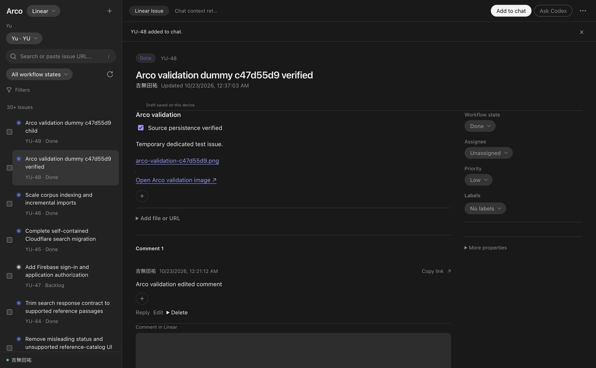

ユーザーの13:34の画像では通常の返信が待機欄に入り、質問UIも開いていた。この画像だけではモデルへの受渡し完了を判定していない。後続の通常返信で受信したpayloadを完了根拠とする。

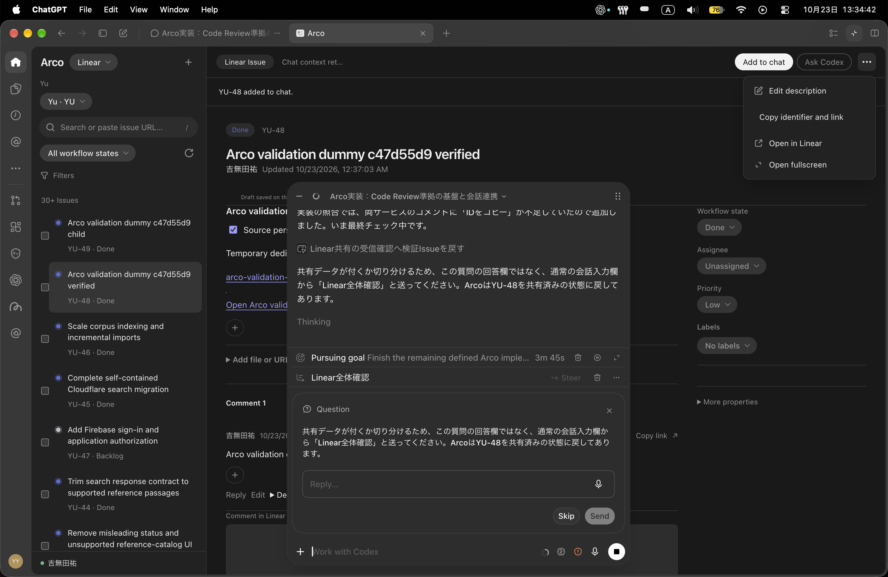

続く通常返信「選択」では、YU-48の本文から`Temporary dedicated test issue.`を選んだselectionを受信した。textとstructuredContentのoriginはbodyで一致し、Issue本文全体のbody fieldとcommentIdはない。native workspace/team/Issue IDは全体共有時と同じである。本文選択はモデル受信まで確認済みとなり、コメント範囲は別途未確認として残す。

実画面のBody selection・31文字のpreviewも一致した。Chat YU-48とCopy comment IDの追加表示があり、最新版UIの反映を確認した。YU-49へ移っても共有対象表示はYU-48を保ち、Different from the issue you are browsingを表示した。共有・送信・元サービスへの書込みは行わず、YU-48へ戻して次のコメント検証に備えた。

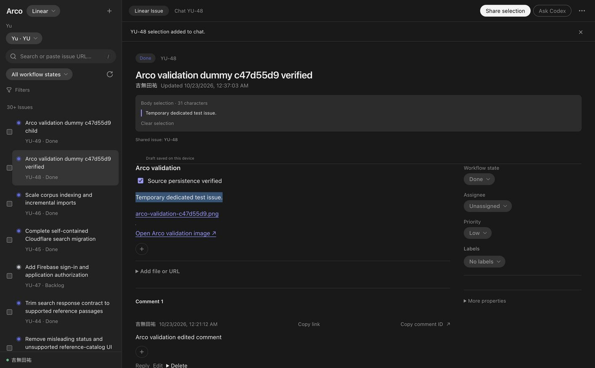

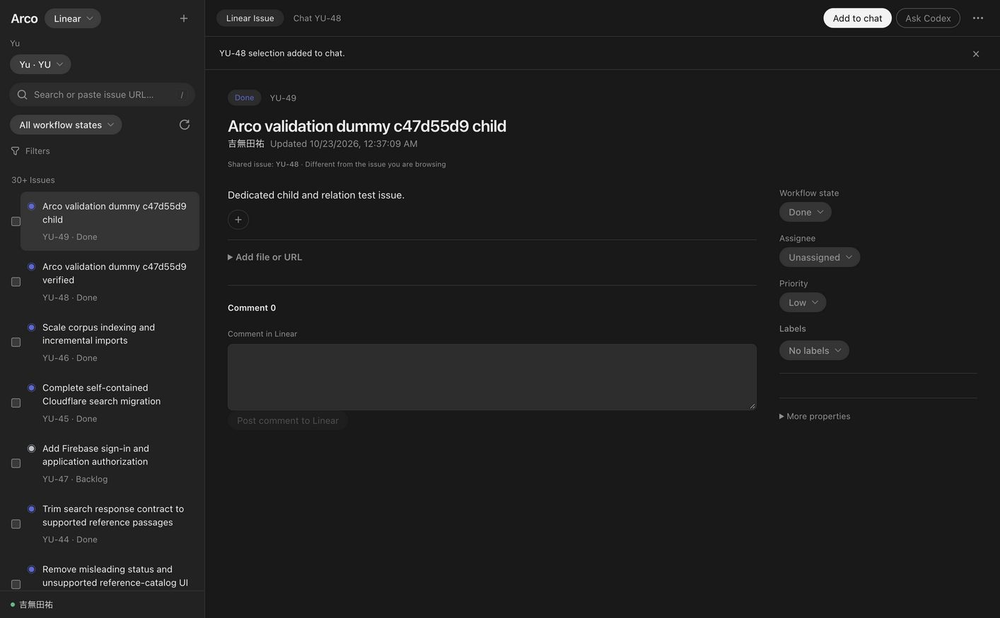

続く通常返信「コメント共有」では、YU-48の`Arco validation edited comment`をselectionとして受信した。textとstructuredContentはorigin=comment、commentId=`f0a36c2d-baaf-4bb8-92ff-b5a719539558`で一致し、Issue本文全体のbody fieldは含まれない。返信への選択文の転記ではない。LinearのIssue全体・本文範囲・コメント範囲はすべてモデル受信まで確認済みとなった。mention、inlineの復帰、実composerの下書き／送信は別の受入項目として残す。

## Remaining operation gaps

残る要件を照合し、両sourceのCopy comment ID、Linearの共有中identifierと閲覧対象との差の表示、未対応Linear templateを元のteam/template ID付きで公式作成画面へ渡す導線を追加した。[公式作成URL](https://linear.app/docs/creating-issues#create-a-new-issue-url)と[templateパラメーター](https://linear.app/developers/create-issues-using-linear-new)を確認し、workspaceの未公開パラメーターは追加していない。既存の共有／template回帰でnative IDと下書き保持、自動の共有・作成が増えないことを確認した。最終browser58件、unit145件、型・lint・format・build・65 tools smoke・artifactが成功。HTMLは1,580,052 bytes、SHA256 `53534e9396ff46b0f02eb1724b758b3fa3319b6e7ba0359b92d21b806680ab95`。installed HTML/serverと一致する。この追加UIの実機反映は再起動後の確認として残す。

## Code Review source comparison

このMacのCode Review `26.1016.61520` の配布JS/CSS/HTMLを再確認した。元のTSX repositoryを取得できたという意味ではない。

- `tIs()` / `YRs()`は内容のナビと操作を分け、実際の幅を計測して補助操作をoverflowへ移す。
- `nOl()` / `tOl()`は状態・repo・番号と、タイトル・作者・日時を区別する。
- `USi()`は詳細container幅800pxを境に、約300pxの右側overviewと本文内overviewを切り替える。
- `Z$l()`は主要な作業、link utility、overflowに別のslotを持つ。
- 文字・toolbarのtokenにはElectron/browserによる上書きがある。固定の数値がすべてのhostで同じ大きさになるとは扱わない。

詳細なソース位置は[Code Review reference](../code-review-reference.md)。公式専用bridgeは呼ばず、Arco自身の表示領域と公開されたcontext/message/display APIで構成する。

## Accessibility and evidence limits

今回の画像は配置・密度・ラベルの発見しやすさを示す。contrast、読み上げ、focus復帰、全操作のkeyboard到達性を画像だけで適合認定しない。変更後は画面幅ごとの再撮影、操作とfocusの確認、既存の編集・draft・共有・表示切替の回帰確認を行う。

実Codexでは、GitHub #1の本文、toolによるタイトル更新の同一view反映、Project Status変更とClosed維持をユーザーが確認済み。GitHub本文の選択範囲は節8のとおりモデル受信まで確認した。共有対象へ戻る処理にはhostによるview再作成を含む回帰確認を追加し、inlineカードでの実Codex確認は引き続き別に残す。PiPは現在の受入条件から外している。
