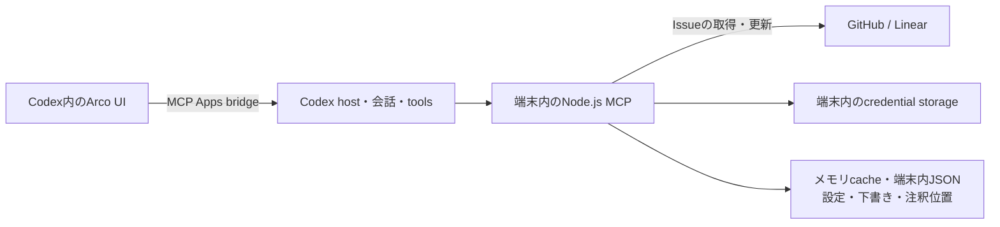

# Arco ユーザー端末優先のデータ境界

更新日: 2026-10-24
状態: 無料pluginとして、UI + local stdio Node.js MCPから元サービスへ接続し、独自backendを作らない構成を採用済み。Code Reviewと同じ構成を優先し、設定・下書きはJSON、表示cacheはメモリから始める。credential保存・認可・起動は既存手段を先に検証し、追加依存は必要性を確認してから選ぶ。

## 意図と構成

Arcoは合意済みの製品scopeを無料で提供する。独自Arcoアカウント、本人確認サービス、利用権の照会・発行基盤は不要とする。
UI assetsとlocal MCPをpluginに同梱し、GitHub/LinearのIssue操作と会話連携を端末内で処理する。合意済みのReact/TypeScript/Node/MCP Appsという基本stackを維持する。

検索・本文・コメント・添付・属性更新はlocal MCPから、GitHub CLI等の公開接続経路を含む元サービスのAPIへ送る。Issueや進捗の正本は元サービスに置き、端末のcacheを独立したIssue管理DBにしない。
local MCPは通常のAPI接続用プロセスであり、独自agent runtime・実行キュー・自動運転管理は持たない。

## 保存・処理する情報

| 情報 | 正本と保存場所 | 方針 |
| --- | --- | --- |
| Issue本文、コメント、ラベル、担当者、Status、親子・依存 | 正本はGitHub/Linear。端末のメモリに表示用cache | 再取得できるcacheとし、Issue mirrorを永続化しない |
| 添付ファイル | 元サービスと必要な端末側処理 | Arco専用ファイル保管先を作らない |
| GitHub/Linearのcredential | CLI等の既存の安全な保存先を優先し、Arcoで管理が必要な分だけ端末内に安全保存 | UI・モデルへ渡さず、共有認証の複製を前提にしない |
| 接続先の識別情報・scope・失効状態 | 端末 | tokenと接続先を対応させ、別利用者の接続と混同しない |
| repo/team/Project一覧、検索条件・選択・閲覧状態 | 端末と元サービス | UIの表示範囲とproviderの認可範囲を区別する |
| 下書き、表示設定、保存filter | OS標準の保存先にJSONで保持 | tokenを混ぜず、端末間同期を追加しない |
| チャットと手動選択したGitHub repoの紐付け | 端末内の設定JSON | thread IDから作るSHA-256をキーにし、生のIDや作業pathを保存しない。直近100件を保持し、個人ビューの選択・条件と分ける。hostがworkspace rootsを提供する場合のみ作業場所由来のキーを使う |
| 注釈の位置 | 端末内の`annotations.json`に最新100 snapshotを保持 | UUID・注釈番号・Issue識別情報・DOM pathとoffset・hashを保存し、選択文・コメント・入力欄の全文は保存しない。Codexへは対応するsnapshot UUIDを添える |
| 認可途中のstate・PKCE verifier・device code | 端末の短期情報 | 完了・取消・失効後に残さない |
| Codexへの会話追加・モデル向けtool結果 | Codex/モデルへ渡す | 選択したIssue情報と操作に必要な結果に絞る |

独自backend・サーバー側の運用DBは作らない。アカウント・契約・利用権の保存も不要。
配布ZIP・UI assets・導入案内ページ等の静的hostingは利用できる。Issue操作やアカウント管理のAPIを運営することとは区別する。
source tokenをiframe、`_meta`、tool結果、モデルcontext、通常ログへ含めない。設定・下書きのJSONにtokenを保存しない。

## 保存と競合制御

Codexアプリが対応する環境で動く方針とし、macOS・Windows・Linuxの実際の対応OS・archで検証する。headless環境やCLIのサポートをこの保存方式から自動追加しない。

| 役割 | 小さく始める方針 |
| --- | --- |
| credential | GitHubは`gh`の既存認証を先に検証する。Linear等でArcoが保存する必要がある場合に、安全な保存手段を選ぶ |
| 保存先 | ホストの保存先契約と対象OSの標準pathを確認して決める。path解決packageを先に必須化しない |
| 設定・下書き | JSONと既存Zodによる検証。破損・更新競合を検証し、必要な保存helperだけを追加する |
| 表示cache | UIとlocal MCPのメモリ。永続的な全件index・mirrorは作らない |

`@napi-rs/keyring`、`env-paths`、`write-file-atomic`、`proper-lockfile`は追加が必要な場合の調査候補であり、必須stackではない。Code Reviewで確認したSQLiteはreview状態の保存用途であり、そのままArcoのIssue用DBにする理由にはしない。
Arcoがcredentialを保存する場合も平文JSONへfallbackしない。keyring bindingを採用する場合は、Linux Secret Service固定等の保存先と失敗時の動作を確認する。

複数MCP processからの設定・下書き更新とtoken rotationは実証する。既存の認証経路で処理できるものを重複実装しない。Arcoで排他が必要な場合は接続単位のlock内でcredentialを再取得し、必要時だけrefreshして新token pairの整合性を保つ方法等を検討する。
atomic writeと更新競合対策は別であり、process内のPromise queueだけでprocess間の安全性を保証しない。検証結果に合わせて対策し、追加のdaemonは作らない。

設定・下書きの保存形式が現行形式と合わない場合は、同じファイルのprocess間lock内で自動復旧する。書き換え前に元ファイルと同じディレクトリへ`<元ファイル名>.recovery-<UUID>.bak`を作り、元のバイト列をそのまま保存する。バックアップが完了した後、有効な既知の項目を残し、欠落・無効な項目を既定値で補って現行形式をatomic writeする。廃止済み・未知の項目はバックアップにだけ残す。復旧でもrevisionを更新し、古い画面からの保存は通常の更新競合として扱う。

JSON自体や文字コードが壊れていて読み取れない場合は、元データをバックアップしたうえで設定は既定値、下書きは未保存の状態から再開する。壊れた本文を復元できるとは保証しない。読み書き・バックアップの失敗や更新競合は引き続き画面へ伝える。注釈の`annotations.json`はこの自動復旧の対象外とする。

開発検証にはNode.js 24.22.1を使い、ホストNodeを利用する場合は確認した起動契約に従う。Code Reviewの構成、追加依存の調査・候補と検証事項は[技術スタック](technical-stack.md)、[依存互換性](dependency-compatibility.md)を参照。cache容量、下書きの保持期間、個別削除と接続解除時の削除動作は検証で確定する。

## source認証を端末で完結する候補

- GitHub: Code Reviewを参考に公開`gh` CLI経由を先に検証する。採用操作・個人Projects・導入UXを満たさない場合に自前認可の要否を決める。自前認可が必要なら、secretなしで取得・更新できるdevice flowが候補となる。[OAuth App認可](https://docs.github.com/en/apps/oauth-apps/building-oauth-apps/authorizing-oauth-apps)、[GitHub App更新](https://docs.github.com/en/apps/creating-github-apps/authenticating-with-a-github-app/refreshing-user-access-tokens)
- Linear: PKCEによる認可code交換はclient secretを省略でき、PKCE発行tokenの更新もsecret不要。登録済みcallbackからlocal MCPへ戻る経路を検証する。[Linear OAuth](https://linear.app/developers/oauth-2-0-authentication)
- GitHubの通常のauthorization-code flowはPKCEがあってもsecretが必要なため、device flowと同一視しない。

公開仕様上、provider token保管用backendや交換relayは必須ではない。実際のCodex環境での認可、callback、更新、失効・再接続は未検証。
認可が未検証であることを理由に、source tokenをArco serverへ送る方式へ切り替えない。

自前OAuthが必要な場合は、Node標準`fetch`・`crypto`・`http`による小さなprovider専用helperを候補とする。account/session frameworkは追加しない。Arcoの接続解除と元サービス側のgrant取消は別に扱い、共有`gh`認証を暗黙に削除しない。

LinearのDisconnect Linearは端末内のcredentialを削除し、取得済み表示cacheを解除する。元サービスのgrantは取り消さず、保存済み下書き・設定とCodexの添付を保持する。

## 通信と会話連携の境界

「独自backendを持たない」は、端末からデータを一切送らないという意味ではない。元サービスへのAPI通信があり、UIを表示するCodex hostもデータを受け取る。
会話へ追加するIssue情報やモデル向けtool結果はCodex/モデルへ渡る。ArcoのUI内で閲覧したすべての本文やコメントを、無条件にモデルcontextへ追加しない。

source tokenはlocal MCPが使い、元サービスで許可された本人の権限を超えて操作しない。UIのrepo/team選択だけでprovider認可が限定されたとは表示しない。
未送信の下書きや取得済みcacheは元サービスへ保存済みの情報と分け、更新成功後に元サービスを再取得して表示する。

メモリcacheから閲覧できる情報と、onlineでの認可・更新が必要な操作を区別する。プロセス再起動後のoffline閲覧を保証しない。接続切れ時の表示や下書き保持は決めるが、offlineの変更キューや独自同期エンジンは追加しない。

## 無料提供・ソース公開・配布

ソース非公開の無料pluginとして提供する方針は確定。現時点ではOSS化せず、データ境界と基本構成を維持する。
local MCPとUIのコードは配布先の端末に届くため、client secretやprivate keyを埋め込まない。
Code Reviewで確認したホストNodeの起動経路を先にprobeで検証する。`CODEX_MCP_NODE_PATH`等は公開資料で契約未確認だが、それだけで利用不可とも断定しない。
Nodeの手動導入要求、runtimeやnative binaryの同梱、launcher追加は今決定しない。全OSで追加セットアップ不要とは検証前に保証せず、自動installer・SEA・独自launcher・daemonを先回りして追加しない。

local stdio MCPの公式directory提出には、確認した現行資料でapproved partner/組織allowlistが必要。local優先の構成を一般公開できる資格・経路を確認するまで、公開可能と断定しない。[Desktop-only公開条件](https://developers.openai.com/plugins/deploy/desktop-only)
Arcoの無料提供と、Codex/GitHub/Linear各サービスのアカウント・契約・利用条件は別。無料化だけでpluginの審査適格性やソース公開義務の有無が決まるとは扱わない。

## 残る確認事項

1. 公開`gh`経由でのGitHub採用操作・個人Projects認可・導入UXと、Linearの認可方式。
2. 既存の安全な認証保存・更新の利用可否、Arcoで必要な保存処理、process間更新、接続解除と下書き等の保持動作。
3. Code Reviewと同じホストNode経路での起動、local MCPの公開資格・配布経路、および採用したinline／fullscreen・会話連携の動作。PiPは2026-10-23のユーザー希望で対象外。
4. ソース非公開の無料配布に必要な利用条件と、実際にサポートするCodex環境での検証結果。

認証・配布の根拠と未決事項は[認証・公開配布](auth-distribution.md)、実装で守る条件は[セキュリティとプライバシー](security-and-privacy.md)を参照。
