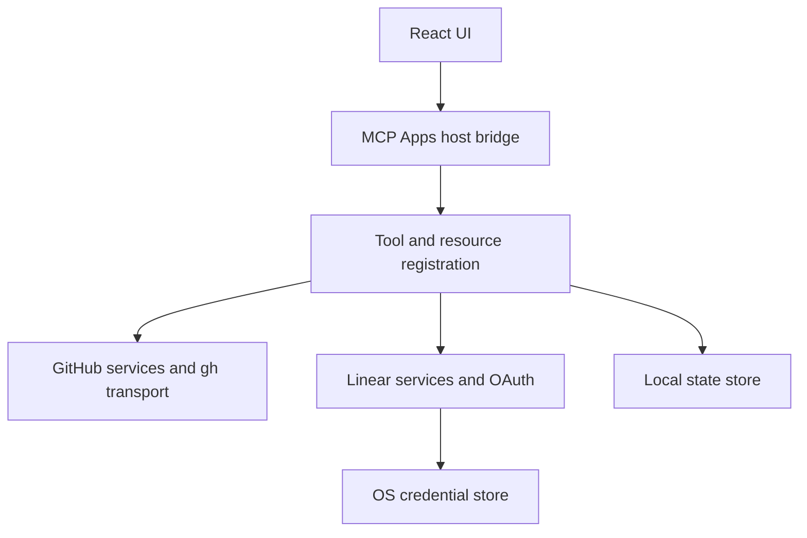

# Technical architecture

Arco uses one npm package and lockfile for a React/TypeScript UI and a Node.js ESM stdio MCP server. The current development baseline is [`.node-version`](../.node-version); exact dependency versions are in [`package.json`](../package.json) and [`package-lock.json`](../package-lock.json).

## Product and process boundary

GitHub and Linear own issue records. Codex owns conversation display and AI execution. Arco owns provider adapters, issue interaction, selected-context handoff, and local preferences/drafts. There is no hosted Arco issue backend or independent agent runtime.

## Source layout

| Location                                          | Responsibility                                                                                                         |
| ------------------------------------------------- | ---------------------------------------------------------------------------------------------------------------------- |
| `src/server/index.ts`, `composition.ts`, `mcp.ts` | Build dependencies, register MCP tools/resources, notifications, stdio connection                                      |
| `src/server/github/` and GitHub facade files      | Transport, issue lists and writes, comments, labels, fields, Projects, relationships, templates, bulk operations       |
| `src/server/linear/`                              | OAuth, connection validation, queries, issue operations, comments, relationships, attachments, upload, bulk operations |
| `src/server/state.ts`, `state-recovery.ts`        | Settings/drafts/annotation storage, locks, revisions, atomic writes, recovery                                          |
| `src/shared/`                                     | Validated contracts and native references shared across server and UI                                                  |
| `src/ui/`                                         | Provider workspaces, inline cards, common controls, host bridge, query/session/draft state                             |
| `plugin/`                                         | Portable and compatibility manifests, MCP launch configuration, skills, icons                                          |
| `scripts/`                                        | Builds, static artifact checks, fixture host, protocol and opt-in live validation                                      |
| `tests/`                                          | Unit/service tests and browser fixture suites                                                                          |

Shared contracts do not contain credentials or server implementations. UI components do not import provider SDKs or server adapters. Common controls do not access providers directly.

## UI and state ownership

TanStack Query owns fetched data and memory caches. Provider browsing sessions own scope, selected issue, filters, list position, and in-flight operations. Shared draft/settings controllers own revisions, save queues, unsent input, conflicts, and failures. Host integration owns display modes, context attachments, acknowledgment/deletion races, and annotation restoration.

Only the active provider workspace mounts its fetches. A background provider can have its cache invalidated without starting hidden browsing work. Switching services preserves drafts and browsing state, and an operation completes into the session that started it.

Common startup tools are `arco_show_issue` for inline display, `arco_open_issue` for explicit details, and `arco_open` / `arco_open_project` for list workspaces. Use strict native references. Do not infer an entrypoint from the host's display mode. See [Screen structure](screen-structure.md) and [Project viewers](project-viewers.md).

Common rendering and control behavior is shared; native workflow semantics and mutation APIs remain provider-specific. GitHub Open/Closed differs from Project Status, and Linear's team state, single assignee, priority, and estimate are not converted into a generic model.

## Server and write behavior

Zod validates input/result boundaries. GitHub invokes the public CLI with argument arrays and explicit methods. Linear validates connection/workspace/team context and uses the SDK or targeted GraphQL queries. List queries request summaries; details, comments, and image requests are staged separately.

Write guards deduplicate identical request IDs and preserve ambiguous outcomes. Mutation receipts distinguish successful writes from subsequent read failures. Fixtures never fall back to live provider traffic.

## Persistence

Local JSON records use process locks, revisions, schema validation, and atomic replacement. Invalid settings/drafts are backed up byte-for-byte before recovering valid fields into the current schema. Invalid annotation records remain errors. Linear token pairs use the OS credential store and connection-specific refresh locks, with no plaintext fallback.

See [Local data](local-data-boundary.md) for paths, retention limits, and recovery semantics.

## Build and dependency compatibility

Vite, Tailwind, and `vite-plugin-singlefile` produce one HTML file. esbuild produces ESM server bundles. `dist/plugin/` contains production assets; `dist/dev/` contains the fixture server and generated diagnostic output. Native keyring packages remain external to the server bundle and are copied for the build platform.

The UI disables math and removes unused external KaTeX font declarations with a PostCSS AST pass. Artifact checks inspect JS/CSS syntax rather than relying only on string searches. Compatibility decisions and dependency caveats are in [Dependency compatibility](dependency-compatibility.md) and [Runtime notes](dependency-runtime-notes.md).

For commands and verification scope, see [Development](development.md). Historical implementation plans in `docs/archive/` describe earlier decisions rather than current contributor instructions.
